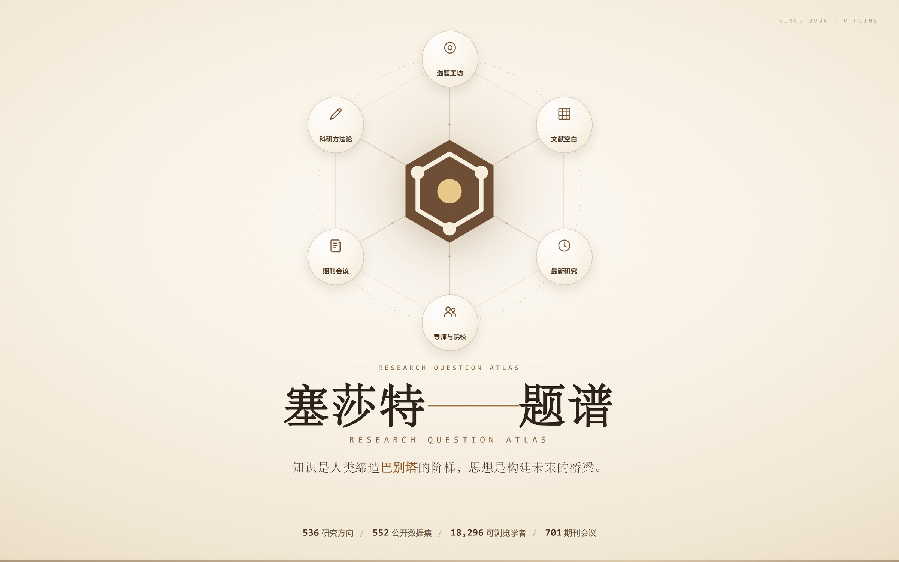
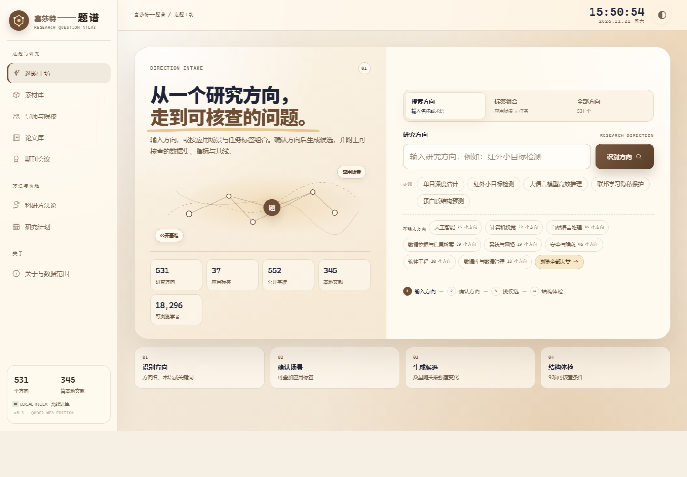
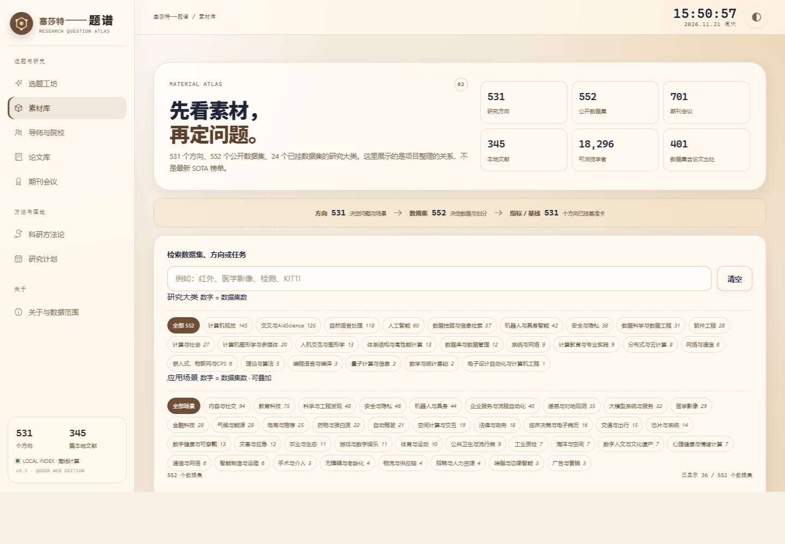
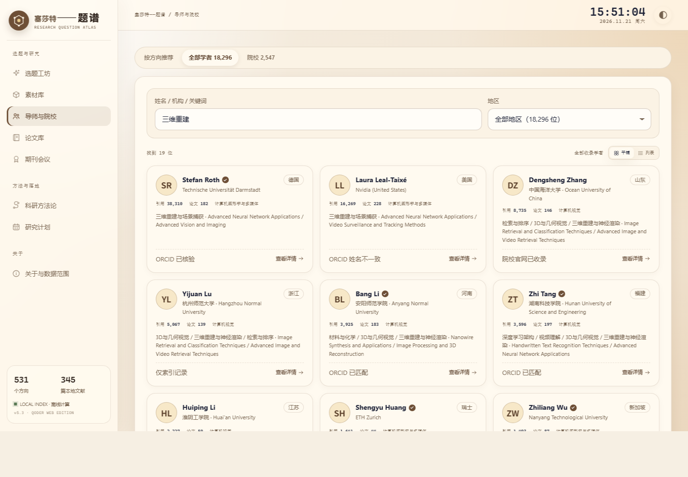
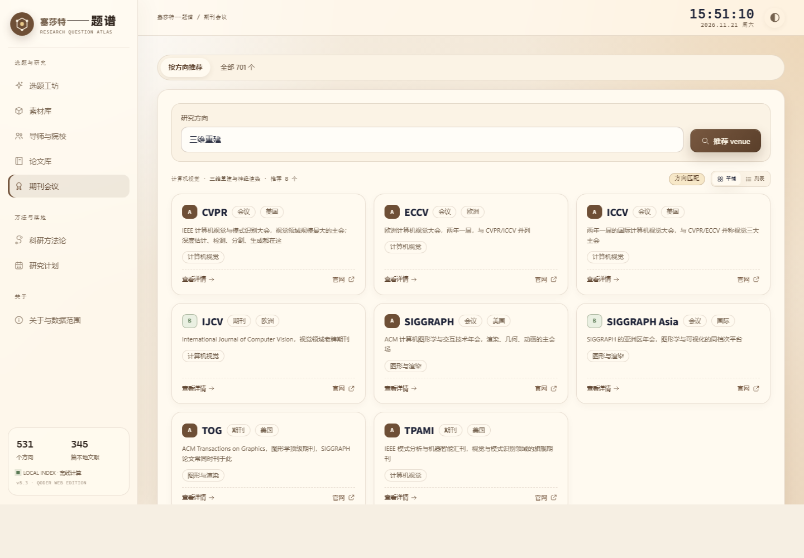
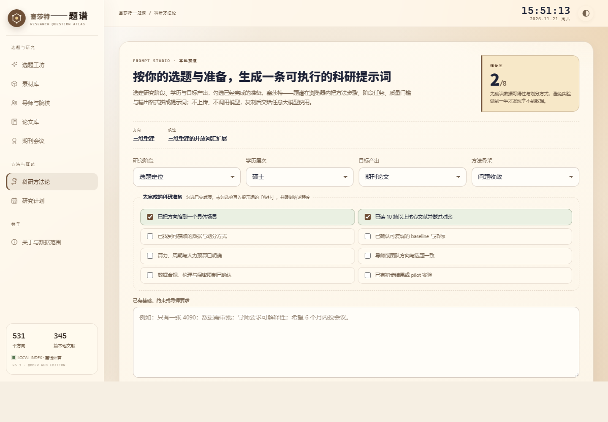
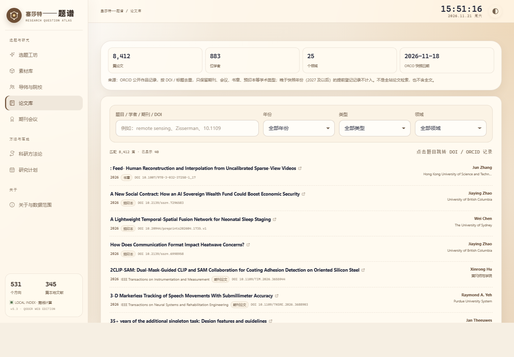

<div align="center">



# Seshat — Topic Atlas

**Research Question Atlas**

**Turn one vague research direction into a chain of checkable decisions.**

[简体中文](README.md) · [English](README.en.md) · [繁體中文](README.zh-TW.md)

[](#latest-updates)
[](#quick-start)
[](#three-zeros)
[](https://topic-compass-jzkhsw942zj.qoder.website)
[](#license)

</div>

---

## Try it in a browser

No Python install required. There is a read-only demo site you can open right now:

**<https://topic-compass-jzkhsw942zj.qoder.website>**

All nine pages work: the topic workshop (type a direction, see the candidate topics with their structural examination), advisors, papers, venues, methodologies, research plan. The data is a bundled public snapshot. No account, and nothing is written to your machine.

It is read-only. To point it at your own PDF library, run the local semantic search, or see the literature-gap view, install the desktop app — next section.

---

## Why it is called Seshat

> "Knowledge is the ladder by which mankind builds the Tower of Babel."

On the road of research I have made countless attempts and studies, and I have mentored batch after batch of younger students. In an age when AI was not yet this capable, so much knowledge, so many techniques, so many of the methods — every researcher explored them in a different way, in a different field. After nights without sleep, after watching the sun come up more times than I can count, those days along the road of research, in the course of raising a tower of Babel out of countless pieces of knowledge, are etched in memory all the same.

So I began to wonder: in today's age of AI, is there a design that could give us seekers a quick way in — a better blade in the hand? Something that could serve, for newcomers who do not yet know how research is done, as an integrated toolbox; something that keeps growing, that each person can adapt into a research assistant of their own. Not help, exactly. Only the wish that everyone could get a better starting point, and go on to do research and make things of their own.

That is how this project, Seshat — Topic Atlas, came about. Why this name? Because Seshat is the ancient Egyptian goddess of writing and record-keeping: knowledge handed down, recorded, and created.

When everything in the world can be recorded, and when a well-made knowledge base can genuinely help you finish what you are building — then whatever use this project turns out to have, I only hope that when you use it, you will remember those nights of sleepless study, and the quiet corner of research that was yours alone, found somewhere in the sea of knowledge.

Go on and build a tower of Babel of your own.

---

## Contents

- [Why it is called Seshat](#why-it-is-called-seshat)
- [Try it in a browser](#try-it-in-a-browser)
- [Why it is called Seshat](#why-it-is-called-seshat)
- [Why it exists](#why-it-exists)
- [Quick start](#quick-start)
- [The problems it answers](#the-problems-it-answers)
- [What we value](#what-we-value)
- [The fourteen pages](#the-fourteen-pages)
- [Three zeros](#three-zeros)
- [Why there is no score](#why-there-is-no-score)
- [The seven research methods](#the-seven-research-methods)
- [Data scale and how it is counted](#data-scale-and-how-it-is-counted)
- [What we refuse to do](#what-we-refuse-to-do)
- [Known limitations](#known-limitations)
- [Maintenance and verification](#maintenance-and-verification)
- [Repository layout](#repository-layout)
- [Latest updates](#latest-updates)
- [Acknowledgements](#acknowledgements)

---

## Why it exists

### 1 a.m., and you open your thirtieth tab

You have probably been through this: your advisor says "go find a direction", you scroll arXiv for two hours, bookmark forty papers, close the laptop, and know less about what to do than you did two hours earlier.

The problem is not effort. The problem is that **the sentence "what is still open in this field?" has nowhere to be looked up**.

Hundreds of thousands of papers sit in a library, but no interface will tell you: "Method A × Task B, last three years, 51 papers. Method C × Task D, none at all." To know that, you would have to read everything — which takes four years, not one evening.

### Choosing a topic is not a moment of inspiration; it is a checklist

After a few conversations with a good advisor, you notice something: **good topics are not invented, they are sieved out**.

- In what setting does the problem described in this sentence fail, at which step, and by how much?
- Who has already done something adjacent? Can I state the difference in one sentence?
- If my mechanism holds, what number should appear on the screen?
- If it simply fails in two weeks, what tells me to stop?

These questions have a standard *form* but no standard answer. Most students are not stuck because they cannot think of an idea. They are stuck because **nobody ever wrote these decision items down as a table and made them tick the boxes**.

### So we built Seshat — Topic Atlas

Seshat — Topic Atlas turns those decisions into an interface. Type a direction, and you get eighteen candidates each with its own argument, a matrix marking the combinations nobody in your library has tried, a nine-item structural audit, a list of real researchers, a list of venues, and seven methods that force you to write things down properly.

It will not decide for you. It only guarantees one thing: **by the time you decide, you have already seen the material you were supposed to see**.

---

## Quick start

### What you need

| Item | Requirement |
| --- | --- |
| OS | Windows 10 / 11 (validated at 125% display scaling) |
| Python | 3.10 or newer (developed on 3.12) |
| Dependencies | `numpy` 1.26 and `scikit-learn` 1.8, plus the Tkinter that ships with CPython. Nothing else. |
| Network | The core is fully offline. Four actions need the internet: *latest research*, *fetch new papers*, *download to library*, *refresh scholar index*. |
| Installation | **There is no installer**, and none is needed. |

### Three ways to launch

```powershell
# 1. Simplest: double-click 启动.pyw (same as python 启动.pyw)

# 2. From the command line: use the python that has numpy / scikit-learn
python app_main.py

# 3. Standalone client without Python (copy the whole folder)
dist\知识库助手\知识库助手.exe
```

> If `python` resolves to an interpreter without the dependencies (for example the system 3.9), point it at the one that has `numpy` and `scikit-learn`, e.g. `C:\Python312\python.exe app_main.py`, or set `KB_PYTHON` (see `start_widget.bat`).

### Try these five sentences

Open **Topic Workshop** and paste any of them. They are ordinary spoken Chinese; Seshat — Topic Atlas first recognises the direction, lets you confirm it, and only then generates candidates.

```text
我对红外小目标检测感兴趣，但不知道还能做什么
做医学图像分割，想找一个能两周内验证的切入点
单目深度估计这个方向还有没有没被做烂的题目
想做模型压缩，但不想和量化剪枝那批人撞车
帮我看看三维重建里有没有方法和任务还没配上的组合
```

*(Translation: "I'm interested in infrared small-target detection but don't know what's left." · "Medical image segmentation — I want an entry point I can validate in two weeks." · "Is there anything not already beaten to death in monocular depth estimation?" · "I want to do model compression without colliding with the quantization/pruning crowd." · "Show me combinations of methods and tasks in 3D reconstruction that haven't been paired yet.")*

### Take a look in the browser first

No install needed — open the public demo: **https://topic-compass-jzkhsw942zj.qoder.website**

That is the **read-only demo surface** of Seshat — Topic Atlas: nine pages (intro, topic
workshop, materials, advisors, papers, venues, methods, research plan, about), a static site, no backend, no model calls, no account. The desktop-only capabilities — the 538k-paper arXiv vector index, PDF full-text search, online LLMs, downloads and profile management — are not available there, and the site says so on its own pages.

---

## The problems it answers

| What you are actually stuck on | What Seshat — Topic Atlas does | Where |
| --- | --- | --- |
| "What is left in my field?" | A method × task × failure-mode matrix; every cell shows whether the library holds dozens of papers or none | Literature Gaps |
| "I have an idea but cannot articulate it" | A nine-item structural checklist; each missing item comes with a concrete action, and there is no score | Topic Workshop |
| "Has someone already finished this?" | Checked only when you open a candidate (never assumed), with real neighbouring papers and a collision-risk band | Topic Workshop |
| "What have peers published lately?" | arXiv / OpenAlex / Europe PMC merged into a month-by-month timeline | Latest Research |
| "Whom should I contact, and who in China does this?" | A 21,847-researcher index, matched by field, filtered by province, searchable by Chinese institution name | Advisors & Institutions |
| "Where do I submit, and when is the deadline?" | Venues matched by field, linking straight to the homepage, with DBLP directory pages clearly marked as *not* homepages | Venues |
| "I have 345 PDFs and cannot find the one I need" | Semantic search that accepts Chinese queries and explains each match | Library |
| "What do I actually do next?" | Pick one of seven methods; each demands a concrete deliverable format | Research Methods |

---

## What we value

**The judgement stays with the user.** Seshat — Topic Atlas supplies material, structure and counter-examples — never a verdict. It does not say "this topic is worth doing"; it says "this one is still missing item 6".

**We never pretend to have done what we did not do.** Novelty checking covers arXiv cs from the last three years, and the page says exactly that. A candidate you have not opened shows no novelty verdict at all. Matching a scholar is not an admission offer, and the interface says "please check the institution's own website". We would rather you take one extra step than spend a month on a false premise.

**Offline first; your data never leaves the machine.** Apart from the four networked actions, everything is computed locally. Your topics, your profile and your memory anchors are not uploaded, not one byte.

**We do not fix layout problems by shrinking type.** The minimum font size is 13 px and every text colour pair is checked against WCAG AA contrast. Density is carried by structure, not by squeezing letters.

---

## The fourteen pages

> Each page answers exactly one question.

| Page | The question it answers | Screens |
| --- | --- | --- |
| **Overview** | What should I do now? (paper count, weekly additions, my topics, next fetch, intake rhythm) | [dark](docs/images/dark/01-home.png) · [light](docs/images/dark/20-home-light.png) |
| **Topic Workshop** | What candidates can this direction be split into — and what is each one's own argument and minimal validation? | [screenshot](docs/images/02-topic.png) |
| **Literature Gaps** | Which "method × task × failure mode" cells are empty across the whole library? | [screenshot](docs/images/03-gap.png) |
| **Latest Research** | What did peers in this field publish in the last three months? | [screenshot](docs/images/dark/08-latest.png) |
| **Idea Library** | Where has each topic I saved actually got to? | [screenshot](docs/images/dark/04-ideas.png) |
| **Research Methods** | Which method patches the specific gap I have right now? | [screenshot](docs/images/dark/09-skills.png) |
| **Advisors & Institutions** | Who works on this in China, in which province and which school? | [screenshot](docs/images/06-mentor.png) |
| **Venues** | Where should I submit — and is that link a real homepage or just a proceedings index? | [screenshot](docs/images/07-venue.png) |
| **Library** | Out of the 345 PDFs on my disk, which one is the one I meant? | [screenshot](docs/images/dark/07-library.png) |
| **Field Map** | Where do these terms I care about sit in the discipline taxonomy? | [screenshot](docs/images/08-map.png) |
| **Research Profile** | Where has my attention actually drifted over the past weeks? | [screenshot](docs/images/dark/11-profile.png) |
| **Settings & Data** | Where are the paths, keys, fetch terms and output folder? | [screenshot](docs/images/dark/12-settings.png) |

Universal controls: `Alt+←` / `Alt+→` or the mouse side buttons for back and forward, clickable breadcrumbs, `Ctrl+K` for full-text search, `Ctrl+Shift+L` to toggle light/dark, `Esc` to close secondary windows.

### A few real screens

Every image below is an actual capture from this repository, not a staged mock-up. These pages come from the Qoder web edition (bottom-left reads `LOCAL INDEX · 离线计算` and `v5.3 · QODER WEB EDITION`). It opens from the workbench address under "About & data scope" and reads the same knowledge base as the desktop app — the figures in the sidebar (536 directions / 345 local documents) are the real readings on this machine.

| Topic Workshop: argued candidates from one direction | Materials: local papers, notes and tags |
| --- | --- |
|  |  |

| Advisors & Institutions: ranked by direction, ORCID-verifiable marked | Venues: labelling a real homepage vs. a DBLP index |
| --- | --- |
|  |  |

| Research Methods: turning your preparation into one runnable prompt | Literature: which of these PDFs is the one I need |
| --- | --- |
|  |  |

---

## Three zeros

| Zero | What it means concretely | What it costs |
| --- | --- | --- |
| **Zero cloud** | Topic generation, structural audit, gap matrix and semantic search all run locally | Nothing — it is actually faster |
| **Zero extra dependencies** | Only `numpy`, `scikit-learn` and the built-in Tkinter. No Electron, no WebView, no openai SDK | The packaged build is 196 MB; still less than half of an equivalent Electron app |
| **Zero API cost** | Every core feature works with no key configured | You forgo the optional "AI critique" and "AI summary" extras |

How does a 538k-paper arXiv index manage to be free? Local `TF-IDF → TruncatedSVD(180 dims) → L2 normalised`, about 1.4 GB on disk, roughly 397 MB resident once loaded, and queries are plain numpy matrix products.

Honestly: **this is not as good as neural embeddings.** The repository says so plainly — on the local 343-paper set, a query made of the first few words of a title gets that paper back at rank 1 in 89.7% of cases and within the top 3 in 97.1% (310 papers scored). Good enough, not impressive. What you get in exchange is offline operation, no GPU burn, and no data leaving your machine.

---

## Why there is no score

Version 4.0 of Seshat — Topic Atlas used to give topics a 0–100 score. We removed it, because it turned out to be gameable:

| Input | Old score | What the system concluded |
| --- | --- | --- |
| A real problem, described plainly | 30 | "Please rewrite your problem definition" |
| **A pile of empty jargon** | **77** | **"Ready to write up"** |

Put "ablation", "baseline", "metric", "single GPU", "stopping condition" in one paragraph and the scoring system awards a high mark — and that high mark convinces the user their topic is already mature.

**What happens instead: no score, only a structural audit.**

| Output | Meaning |
| --- | --- |
| Nine-item checklist | Concrete problem / testable mechanism / named baseline / data and split / metric definition / ablation design / resource estimate / stopping condition / scope narrowing |
| Stage 0–4 | Decided by **hard conditions**, never a weighted average (a weighted average lets fine language paper over a missing limb) |
| Missing items with fixes | Every gap maps to an action you can take today |

And **bare keywords are not allowed to count**: the word "metric" does not define a metric — AP50, F1 or p95 latency must appear. The word "ablation" does not design an ablation — you must state what is ablated and under what equal conditions it is compared. If the paragraph is a keyword dump rather than sentences, every hit is voided and a warning is shown.

Worked examples:

| Input | Conclusion |
| --- | --- |
| Real problem + quantified gap + baseline + split + metric + failure criterion + ablation + compute + stopping condition | `Stage 4 — writable` (8/9 items) |
| Real problem but no mechanism | `Stage 1 — has a problem, lacks a mechanism` (2/9 items) |
| Jargon dump (even with every term present) | `Stage 0 — not yet formed` + warning |

---

## The seven research methods

Saying "you are missing a baseline" is useless on its own. You have to say how to fix it. So seven executable methods are built in, each with a **required deliverable** and **the most common way people fool themselves**:

| Method | When to use it | What you must hand in | The usual self-deception |
| --- | --- | --- | --- |
| Problem Converging | You only have a vague interest | One-sentence problem statement (condition + failure point + quantified gap) + 3 reasons to exclude alternatives | Treating "improve performance" as the problem. Performance is not a problem; failure under a condition is |
| Novelty Check | You have that one-sentence statement | Neighbour worksheet (≥5 papers) + difference statement + 3 novelty reasons | Only searching for papers that support you. You must actively hunt the paper that may have done it already |
| Falsifiable Hypothesis | You have pinned down a mechanism difference | Main hypothesis + null hypothesis + ≥2 alternative explanations + numeric thresholds | Writing "it will improve". A hypothesis with no direction and no magnitude cannot be falsified |
| Minimal Experiment | You have a hypothesis and have not started coding | Experiment table (baseline / change / metric / result / pass?) + a one-line conclusion | Starting with full ablations on full datasets. A minimal experiment answers exactly one question |
| Evidence Bar | The minimal experiment worked and you want to scale up | Evidence list (required / bonus) + failure-slice analysis plan | Reporting only the average. The average hides the failing slice — and that is exactly what reviewers attack |
| Reviewer Simulation | The topic is shaping up; you are about to submit or apply | 3 rejection reasons + 3 remedies + a statement of the conclusion's boundaries | Running it silently in your head. Only what is written down is a real check |
| Proposal Structure | You have results and need a proposal or a paper | Five-part narrative skeleton + 3 contribution statements + a limitations paragraph | Writing methods and experiments first and thinking about the problem last. Reviewers read from the problem |

After a structural audit in Topic Workshop, you can click "improve this topic with a method" and it strings the methods matching your current gaps into a "do these steps first" plan.

---

## Data scale and how it is counted

**A number without its counting method is noise.** Every figure below can be reproduced from a file in this repository; the full counting history lives in [`docs/origin/README.legacy-full.md`](docs/origin/README.legacy-full.md).

### Desktop (as of 2026-11-20, after merging with the public site; counted from files)

| Item | Count | Note |
| --- | --- | --- |
| Research directions | **536** | 531 real directions + 5 retrieval aliases |
| Discipline categories | **25** | ACM/IEEE-CS/AAAI CS2023 + CCF technical committees + OpenAlex topic mapping |
| Venues | **701** | 677 carry a `ccfEdition` field (i.e. a CCF catalogue edition) |
| Venue links | **705** | 174 official / 527 DBLP directories / 4 search fallbacks |
| Scholars indexed | **21,847** | From `advisor_directory_full.json`; the public site shows 18,296 |
| Institutions | **3,178** | Full institution table; 2,404 appear in the scholar data, 2,162 of them have Chinese names |
| Local PDFs | **345** | On disk; 344 of them parsed into a title and abstract (341 titles, 329 abstracts) |
| Public benchmark datasets | **552** | 25 metrics / 25 baselines / 72 directions |
| ORCID publications | **8,412** | Public-site scope, with DOIs |
| arXiv vector index | **538,189** | cs category, TF-IDF + 180-dim SVD |

### Three merge rules (each learned the hard way)

1. **Never deduplicate venues by name.** The same name in different catalogues can point at different ISSNs.
2. **A scholar is unique by (name, institution) only.** Name-only matching once collapsed 391 distinct people called "Hui Li" into one.
3. **The two literature sets do not line up.** Desktop holds PDFs that were actually read; the public site holds publications that exist. The titles have zero overlap, so we do not force a merge.

### Public demo scope (different from desktop — do not mix them)

24 categories / 531 directions (+5 aliases) / 345 local titles counted / 701 venues / 18,296 scholars in the searchable index.

---

## What we refuse to do

1. **We do not fabricate.** No invented results, citations, venue rules, or "nobody has done this". Every count carries its scope.
2. **We read only what is needed.** Private PDFs, keys and personal profiles are read only as far as the task requires; the key file is masked by default and can be wiped in one click.
3. **Network access needs your consent.** External search, downloads and model calls are explicit actions, never silent background fetching.
4. **Every conclusion must be refutable.** Each judgement states its basis and its range; the gap page says outright that "a gap is not necessarily an opportunity — it may simply be something that should not be done".
5. **We do not promise what we cannot deliver.** Matching a scholar is not an admission slot; "not found" in novelty checking only means "not found within what we can see".

---

## Known limitations

This is the section to audit. **Every line was measured, not guessed.**

| # | Limitation | Severity | Workaround |
| --- | --- | --- | --- |
| 1 | Novelty checking covers arXiv cs only for the last three years; journal versions, camera-ready proceedings and industrial work are out of scope | **High** | Read "not found" as "not found within our visibility" |
| 2 | Scholar matching ≠ an admission slot | **High** | Always check the institution's own page |
| 3 | Semantic search is TF-IDF + SVD, not neural embeddings; top-1 occasionally drifts | Medium | Rephrase the query; use global search |
| 4 | Literature Gaps only counts the 345 local papers | Medium (mitigated) | Every gap is cross-checked against the 538k arXiv index |
| 5 | 35 of the 531 real directions return no scholar at all (a further 207 read as zero in the map's exact keyword count) | Medium | The mentor page falls back to nearby categories; the map labels them "no scholars yet — the index does not cover it, which does not mean nobody works on it" |
| 6 | A narrow direction may have very few people (depth estimation has 3) | Medium | Results are annotated "adjacent field: stereo vision & SLAM" |
| 7 | Author extraction succeeds on 53% of PDFs; about 40 titles are wrong (two-column PDFs cap out near 74%) | Medium | Check title and venue by eye |
| 8 | Europe PMC skews biomedical; S2 / DBLP / CORE / Crossref are currently unavailable, leaving three sources | Medium | Europe PMC can be toggled off |
| 9 | OpenAlex's free tier is 10,000 credits/day, resetting at UTC 00:00 (08:00 Beijing) | Medium | Spread fetches across days; HTTP 429 already backs off |
| 10 | Library "categories" are folder names, not disciplines | Medium | Use semantic search instead |
| 11 | The phone view cannot work offline (plain http on a LAN does not register a Service Worker) | Medium | Use "add to home screen" |
| 12 | The web end is read-only: 5 views; download / keys / profile / full-text search / fetching all return 403 | By design | Do it on the desktop |
| 13 | Candidates are combinatorially generated and do not guarantee novelty | Medium (mitigated) | Check the candidates you actually open |
| 14 | Novelty is checked only for the candidates you open (about 7 s the first time, 0.6 s after) | Low | Unexamined candidates show no verdict — we never fake one |
| 15 | The 60,000-paper pre-screen pool slightly under-counts AND matches (89→69, 1279→1208) | Low | Conclusions are bands, not exact counts |
| 16 | The packaged build is 196 MB (onedir) | Low | Compress it yourself |
| 17 | Fetching is fully manual; no scheduled task is registered, and failures do not pop up | Low | The settings page shows the failure count and offers retry |
| 18 | After an index-format change, an old machine must rebuild once: about 8 minutes with 825 MB of source data on disk | Low | It still runs without rebuilding (reads the old format, just slower) |

---

## Maintenance and verification

```powershell
# Design tokens and theme consistency (failures must be 0)
python check_tokens.py

# UI self-checks (these really open windows)
python tools_smoke_app.py      # 12 checks
python tools_e2e_test.py       # end to end
python tools_test_nav.py       # back/forward and breadcrumbs
python tools_test_web.py       # web end (starts a real HTTP server)
python tools_test_personalize.py
python tools_test_chat.py

# Layout and screenshot regression (1440x900 / 1240x800 / 1080x680)
python tools_shots_all.py 1440 900
python tools_scan_layout.py 1440 900

# Public demo regression (serve in another window first)
cd competition\site\dist; python -m http.server 4173 --bind 127.0.0.1
node competition\scripts\check_site.mjs          # 158 assertions, including NO_CONSOLE_ERRORS
```

**Tests never touch your data**: `tools_isolate.py` redirects user data into a temporary directory, and you can confirm afterwards that the mtime of `research_memory.json` is unchanged.

> **These checks are not an efficacy study.** They prove that the UI does not crash, the data stays clean and the assertions hold. They do not prove that Seshat — Topic Atlas helps you choose better topics than some other tool — that would need real users and real topics in a controlled comparison, and we have not run one.

---

## Repository layout

```text
knowledge-monitor/
├─ app_main.py              # main window, navigation, assembly of the fourteen pages
├─ app_theme.py             # widget library (T.Btn / T.Card / T.ScrollArea …)
├─ design_tokens.py         # single source of design tokens: colour, type scale, radius, spacing
├─ page_*.py                # the fourteen pages, one file each
├─ topic_gen.py             # candidate generation: direction × approach (22 approaches)
├─ research_diagnose.py     # nine-item structural audit, hard-condition staging
├─ research_gap.py          # literature-gap matrix
├─ novelty_check.py         # duplicate checking against the whole arXiv index
├─ research_skills.py       # the seven methods (id/name/en/when/goal/steps/output/pitfall)
├─ advisor_index.py         # scholar index: four sources merged, ORCID-first deduplication
├─ kb_vector.py             # 538k-paper arXiv vector index
├─ semantic_search.py       # TF-IDF + SVD retrieval over the 345 local papers
├─ paper_sources.py         # OpenAlex / Europe PMC / arXiv adapters
├─ web_server.py            # web end (read-only, 5 views, 7 open / 5 refused)
├─ web_static/              # web-end front end
├─ competition/
│  ├─ site/                 # source of the public demo site
│  └─ scripts/              # data export, verification, screenshots
├─ docs/
│  ├─ origin/               # archived documents (legacy README, feature manual, etc.)
│  ├─ images/               # screenshots used by this README (light scenes + dark/ with all 14)
│  └─ screenshots/          # screenshots used by the documentation
├─ tools_*.py               # test and utility scripts
└─ AGENTS.md / PRODUCT.md / DESIGN.md
```

How to refresh the README images (skipping step 1 is how the numbers drift):

```bash
# 1. interaction check under an isolated profile; also writes 1440×900 captures to screenshots/new/
python tools_shots_all.py 1440 900
# 2. full-window captures (with chrome, plus the light theme); size comes as a positional argument
python -X utf8 tools_shot_pages_all.py 1440x900
# 3. copy the images you want into docs/images/, then validate every image and anchor
python check_tokens.py
```

---

## Latest updates

> A short selection. The full audit trail is in [`docs/origin/README.legacy-full.md`](docs/origin/README.legacy-full.md).

### The right-hand column of "Literature Gaps" was always empty · 2026-11-20

In `page_gap.py`, `_render_issue_gaps(self, issue_gaps, holder)` declares a parameter called `holder`, but the body used `box` throughout — and `box` was never defined in that scope. Every "problem dimension" card therefore raised `NameError: name 'box' is not defined`, and the column stayed blank until the full-library verification callback ran.

It survived this long not because it was subtle but because **nothing was looking**: the screenshot script captured the page as soon as any row existed, which meant it photographed the loading state, and the red status-bar message was overwritten by "ready" six seconds later. Two gates were added: a red "runtime error" in the status bar now fails the run outright, and the advisor page is only considered finished once its button stops saying "matching…".

### The landing page no longer goes blank in tall, narrow windows · 2026-11-20

On the public demo, a tall and narrow window such as 1189×1475 used to push the illustration out of the first screen, leaving nothing on the right but an orbital ring. The root cause was a single `max-width: 960px` breakpoint in `intro.css` that collapsed the layout to one column at *every* width.

A new breakpoint at `min-width: 1121px` together with `min-height: 1242px` restores the two-column layout; the illustration is now sized by JavaScript from the container's real width and height, and a decode failure collapses it cleanly instead of leaving a hole. Nine window sizes, from 700×900 to 1920×1080, were verified screenshot by screenshot.

### Venue links no longer pretend to be homepages · 2026-11-20

527 of the 701 links are actually DBLP proceedings indexes: they list papers by year and carry no deadlines and no templates. The page now distinguishes them explicitly — real homepages are labelled "官网 ↗", DBLP pages "DBLP ↗" — and the detail panel adds "this is only the DBLP directory of past editions; it contains no deadlines, templates or page charges".

In the same round, the web end's taxonomy was corrected from 12 categories / 64 sub-fields to 25 categories / 536 directions (it had been reporting the 16 extracted PDF text files as the number of categories), and the scholar merge rule was fixed for Unicode hyphen variants that had split one person into two records.

### It also runs after you move it to another machine · 2026-11-20

Three paths used to be hard-wired to this machine. On another computer they did not raise an error — they just **quietly removed features**: the literature index used absolute paths as keys, so a different drive letter lost every title, abstract, author and full-text hit; the arXiv vector index was pinned to `G:\kb-vector`; and the default knowledge-base path was absolute too.

Index keys are now written as `<knowledge-base>/新论文/xxx.pdf`, independent of the drive (both forms are accepted, no re-index needed); the vector index is resolved from the `KB_VECTOR_DIR` environment variable, then `kb_vector_path` in `config.json`, and only then the old default; and the knowledge base defaults to the `知识库/` folder next to the program. When the index genuinely is not on the machine, “Literature Gaps” now says which directory it looked in and how to point it somewhere else, instead of silently returning nothing.

### Wording and numbers brought back in line · 2026-11-21

Every hard-coded count in the three READMEs was re-totalled against the data: the desktop app has 14 pages (the heading used to say “the twelve pages”), the public demo site has 9 pages (it used to say 7), the researcher index holds 21,847 people, and there are 345 local PDFs, 344 of which yielded a title and an abstract. The same round removed rich-text titles that came straight through from ORCID — 46 of the 8,412 publication records carried markup such as `<p style=...>` or `<div><span>`, and the web edition was printing those tags as literal text. The tags are now stripped in place, and subscripts like `R<sub>y</sub>` are no longer split into `R y`.

## Acknowledgements

- Discipline taxonomy follows the **ACM / IEEE-CS / AAAI CS2023** curricula and the **CCF** technical-committee classification.
- Scholar and topic data come from **OpenAlex** (CC0); identity verification comes from **ORCID**.
- Paper metadata comes from **arXiv**, **OpenAlex** and **Europe PMC**; the venue catalogue follows the **CCF Recommended List of International Conferences and Journals**.
- The names "题谱 (Research Question Atlas)" and "Seshat" come from the Egyptian goddess of writing and measurement — turning directions into a genealogy is precisely the shape of this work.

---

## License

See the LICENSE file at the repository root for the code licence. Third-party data (OpenAlex / ORCID / arXiv / Europe PMC) remains under its own licence; this project references and aggregates it and does not redistribute the original datasets.

---

<div align="center">

**Seshat — Topic Atlas will not tell you what to work on.**
**It only makes sure that, by the time you decide, you have already seen what you needed to see.**

</div>
