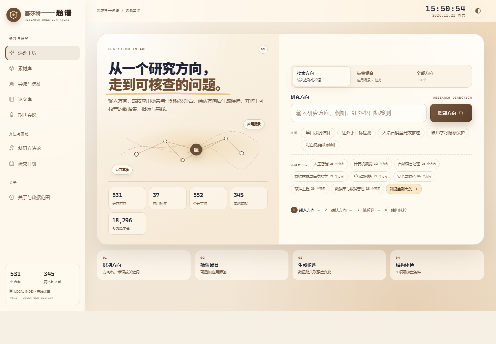
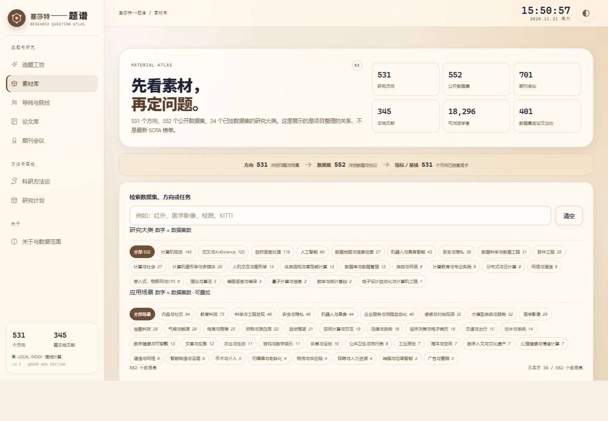
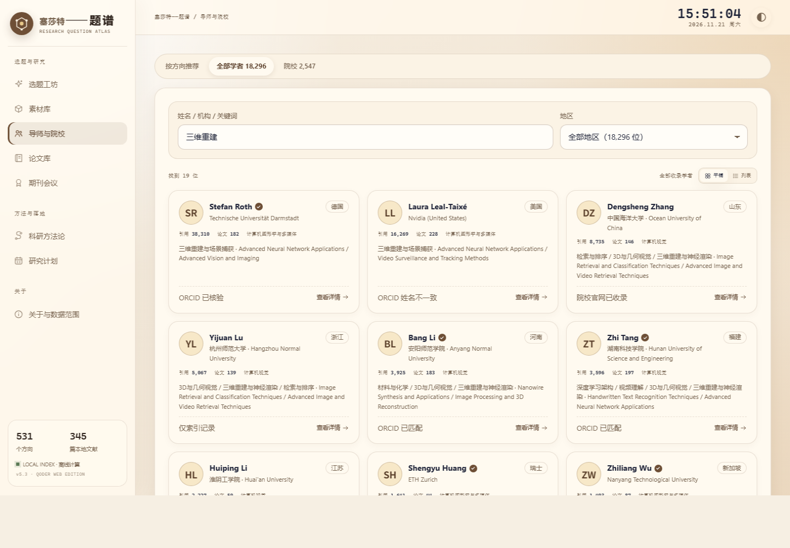
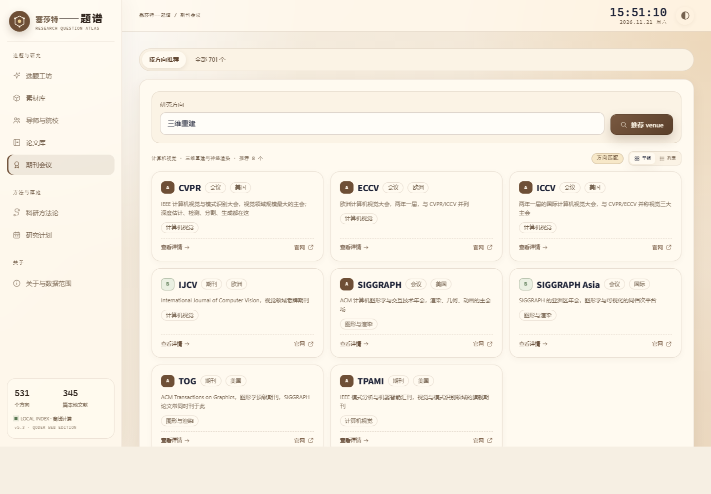
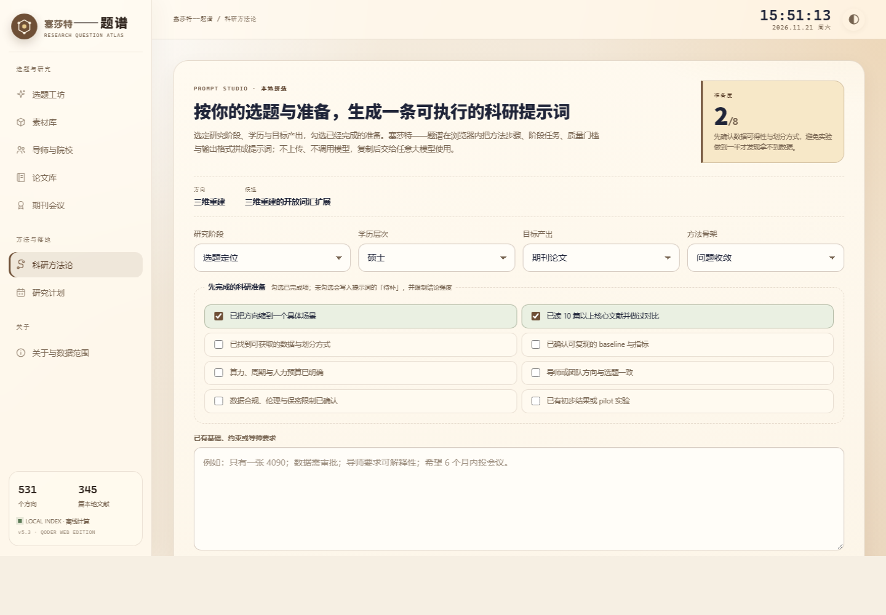
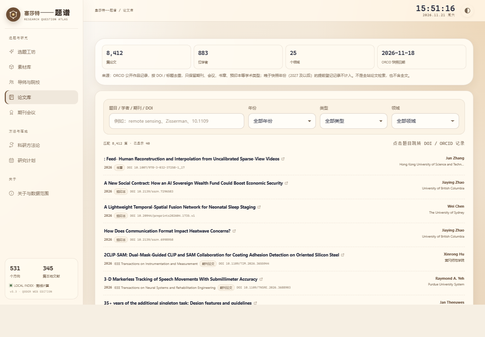

<div align="center">


# 塞莎特——题谱

**Research Question Atlas**

**把一句模糊的研究方向，拆成一串可以逐条核实的选题判断。**

[简体中文](README.md) · [English](README.en.md) · [繁體中文](README.zh-TW.md)

[](#最新更新)
[](#快速开始)
[](#三个零)
[](https://topic-compass-jzkhsw942zj.qoder.website)
[](#许可)

</div>

---

## 网页试一下

不想先装 Python？这里有一个只读演示站，打开就能用：

**<https://topic-compass-jzkhsw942zj.qoder.website>**

九个页面都能逛：选题工坊（输入一个方向，看候选选题和它的结构体检）、导师与院校、文献库、期刊会议、科研方法论、研究计划。数据是打包好的公开快照，不用登录，也不会往你的机器上写任何东西。

它只读。要用自己的 PDF 文献库、跑本地语义检索、看「文献空白」，还是装桌面端 —— 见下一节。

---

## 为什么叫塞莎特

> 「知识是人类缔造巴别塔的阶梯」

在探索科研的道路上，我做过无数次尝试与研究，也带过一批又一批的学弟学妹。在 AI 不那么发达的时代，很多知识、很多技术、很多次的方法，都是每一个科研人用不同的方式在不同的领域进行不断的探索。熬过很多个日夜，看见过多少次太阳升起，在科研的道路上，在无数知识所缔造的巴别塔的过程中，那些日子是如此的印象深刻。

因此，我想，在当下的 AI 时代，有没有一种设计，能帮助我们这些求道者一个入门的快速方式，一个更好的神兵利器，能够作为在许多不知道怎么科研的新手面前，一个整合的工具箱？一个能够在不断开发和提升的、适合每个人自己的一个科研助手——也不能说是帮助，只是希望各位能够获得更好的一个起点，去做各种各样的研究与内容。

所以，塞莎特（Seshat）题谱这个项目，我们就在这样的想法下诞生了。为什么选择这个名字呢？因为她是古埃及主管抄写和记录的女神，代表着知识的传承、记录与创造。

当世间一切都可以被记录，当所谓的知识库的设计能够更好地帮助完成自己的创造，那么，这个项目无论起到了什么作用，只希望你在使用时，能够想起那些个不断钻研知识时所熬的夜晚中，在知识的海洋里寻找着独属于自己的那一份科研净土。

建立起属于自己的巴别塔吧。

---

## 目录

- [网页试一下](#网页试一下)
- [为什么叫塞莎特](#为什么叫塞莎特)
- [它为什么存在](#它为什么存在)
- [快速开始](#快速开始)
- [研究者遇到的困境，塞莎特——题谱怎么回应](#研究者遇到的困境塞莎特题谱怎么回应)
- [我们珍视什么](#我们珍视什么)
- [十四个页面](#十四个页面)
- [三个零](#三个零)
- [为什么没有分数](#为什么没有分数)
- [七套科研方法论](#七套科研方法论)
- [数据规模与口径](#数据规模与口径)
- [我们坚持的底线](#我们坚持的底线)
- [已知限制](#已知限制)
- [维护与验证](#维护与验证)
- [仓库结构](#仓库结构)
- [最新更新](#最新更新)
- [致谢](#致谢)

---

## 它为什么存在

### 凌晨一点，你打开第三十个标签页

你大概经历过这样的时刻：导师说「你先找个方向」，你在 arXiv 上翻了两小时，收藏了四十篇论文，关掉电脑，发现自己比两小时前更不知道要做什么。

问题不在你不努力。问题在于——**「这个方向还有什么可做」这句话，没有地方可以查**。

论文库里躺着几十万篇论文，但没有任何一个界面会告诉你：「方法 A × 任务 B 这个格子，最近三年有 51 篇；而方法 C × 任务 D 这个格子，一篇都没有。」你得自己读完所有论文才能知道这件事，而读完所有论文需要四年，不是一个晚上。

### 选题不是灵感的产物，是一串可以检查的判断

跟导师聊过几次以后，你会慢慢发现：**好的选题不是想出来的，是被一条一条筛出来的**。

- 这句话描述的问题，在什么场景、哪一步失败？差多少？
- 已经有谁做过相近的事？我和他们的差别，能不能用一句话说清？
- 如果我的机制成立，屏幕上应该出现一个什么样的数？
- 如果两周后它就是不行，我靠什么承认失败？

这些问题有标准答案形式，但没有标准答案。大多数学生卡住的不是「想不出点子」，而是**从来没有人把这些判断项列成一张表，让他挨个打勾**。

### 所以我们做了塞莎特——题谱

塞莎特——题谱把这些判断做成界面：输入一个方向，它给你 18 条带独立论证的候选、一张指出「全库没人做」的组合矩阵、一份 9 项结构体检、一份真实学者名单、一份期刊会议名单，以及七套逼你把话说清楚的方法。

它不会替你决定做哪条。它只是保证——**在你决定之前，该看的材料你都已经看到了**。

---

## 快速开始

### 你需要什么

| 项目 | 要求 |
| --- | --- |
| 系统 | Windows 10 / 11（125% 显示缩放已验证） |
| Python | 3.10 及以上（开发环境用 3.12） |
| 依赖 | `numpy` 1.26、`scikit-learn` 1.8，外加标准库自带的 Tkinter；无其他三方包 |
| 网络 | 核心功能完全离线；「最新研究」「抓取新论文」「下载到知识库」「刷新学者库」四件事需要联网 |
| 安装 | **没有安装程序**，也不需要安装程序 |

### 三种启动方式

```powershell
# ① 最简单：双击 启动.pyw（等价于 python 启动.pyw）

# ② 命令行：用你装好 numpy / scikit-learn 的那个 python
python app_main.py

# ③ 免 Python 的独立客户端（整目录拷走即可）
dist\知识库助手\知识库助手.exe
```

> 如果 `python` 指向的是一套没装依赖的解释器（比如系统自带的 3.9），换成装了 `numpy` 和 `scikit-learn` 的那一个，例如 `C:\Python312\python.exe app_main.py`，或者设个环境变量 `setx KB_PYTHON "…\python.exe"` 给 `start_widget.bat` 用。

### 试一下这五句话

打开「选题工坊」，把下面任何一句粘进去。这些都是真实的中文口语，它会先识别方向、再让你确认、最后才生成候选。

```text
我对红外小目标检测感兴趣，但不知道还能做什么
做医学图像分割，想找一个能两周内验证的切入点
单目深度估计这个方向还有没有没被做烂的题目
想做模型压缩，但不想和量化剪枝那批人撞车
帮我看看三维重建里有没有方法和任务还没配上的组合
```

### 想在浏览器里先看一眼

不用安装，直接打开公开演示站：**https://topic-compass-jzkhsw942zj.qoder.website**

那是塞莎特——题谱的**只读演示形态**（9 个页面：开场、选题工坊、素材库、导师与院校、文献库、期刊会议、科研方法论、研究计划、关于与数据范围；静态站，不接后端、不调模型、不需要账号）。桌面端独有的 53.8 万篇 arXiv 向量查重、PDF 全文检索、在线大模型、下载与画像管理，在演示站上不提供——这一点站在页面上写明了。

---

## 研究者遇到的困境，塞莎特——题谱怎么回应

| 你真正遇到的问题 | 塞莎特——题谱的做法 | 在哪一页 |
| --- | --- | --- |
| 「我这个方向还有什么可做？」 | 方法 × 任务 × 问题维度的组合矩阵，每个格子标出全库有几十篇还是 0 篇 | 文献空白 |
| 「有想法，但说不清楚」 | 9 项结构清单逐条核查，缺哪项就给哪项的具体动作；不给你一个分数 | 选题工坊 |
| 「这条题是不是已经被人做完了？」 | 候选点开才核查（不假装核过），给出真实近邻论文与撞车风险档位 | 选题工坊 |
| 「最近同行都在发什么？」 | arXiv / OpenAlex / Europe PMC 三源合并，按月份排时间线 | 最新研究 |
| 「找谁？国内谁在做这个？」 | 21,847 位研究者索引，按方向匹配、按省份筛选、按院校中文名查 | 导师与院校 |
| 「投哪？截稿什么时候？」 | 按方向匹配期刊会议，直达主页，并明确标注哪些链接只是 DBLP 目录 | 期刊会议 |
| 「库里就 345 篇 PDF，我搜索找不到想找的」 | 中文输入做语义检索，附匹配理由 | 文献库 |
| 「下一步到底该干什么？」 | 七套方法里挑一套，它要求你交出一个具体格式的产出 | 科研方法论 |

---

## 我们珍视什么

**判断权在使用者手里。** 塞莎特——题谱给材料、给结构、给反例，不给结论。它从不写「这条选题值得做」，只写「这条还缺第 6 项」。

**没做过的事不装作做过。** 新颖性核查只覆盖 arXiv cs 近三年，页面上就这么写；候选没点开就不显示核查结论；学者匹配不等于招生名额，界面上标了「请查院校官网」。宁可让你多走一步，也不让你在错误前提上多花一个月。

**离线优先，数据不出机器。** 除四个联网功能外，全部计算在本机完成。你的选题、画像、记忆锚点，一个字节都不上传。

**不靠缩小字号解决布局问题。** 字号下限 13px，全部对照 WCAG AA 校验对比度。信息密度靠结构承担，不靠把字挤小。

---

## 十四个页面

> 每个页面只回答一个问题。

| 页面 | 它回答的那个问题 | 界面 |
| --- | --- | --- |
| **总览** | 现在该做什么？（文献数、本周新增、我的选题、下次抓取时间、入库节奏） | [暗色](docs/images/dark/01-home.png) · [浅色](docs/images/dark/20-home-light.png) |
| **选题工坊** | 这个方向能拆出哪些候选？每条候选自己的理由和最小验证是什么？ | [截图](docs/images/02-topic.png) |
| **文献空白** | 全库里哪些「方法 × 任务 × 问题」的格子是空的？ | [截图](docs/images/03-gap.png) |
| **最新研究** | 这个方向最近三个月同行发了什么？ | [截图](docs/images/dark/08-latest.png) |
| **创新点库** | 我攒下来的这些选题，各自走到哪一步了？ | [截图](docs/images/dark/04-ideas.png) |
| **科研方法论** | 我现在缺的那一块，该用哪套方法补？ | [截图](docs/images/dark/09-skills.png) |
| **导师与院校** | 这个方向国内有谁在做？在哪个省、哪所学校？ | [截图](docs/images/06-mentor.png) |
| **期刊会议** | 这个方向该投哪里？入口是官网还是只是个论文集目录？ | [截图](docs/images/07-venue.png) |
| **文献库** | 我硬盘上这 345 篇 PDF，哪一篇是我要的？ | [截图](docs/images/dark/07-library.png) |
| **方向图谱** | 我感兴趣的这几个词，在学科体系里分别落在哪？ | [截图](docs/images/08-map.png) |
| **个人画像** | 我这段时间的注意力到底偏到哪里去了？ | [截图](docs/images/dark/11-profile.png) |
| **设置与数据** | 路径、密钥、抓取词、产出目录都放在哪？ | [截图](docs/images/dark/12-settings.png) |

界面通用操作：`Alt+←` / `Alt+→` 或鼠标侧键前进后退，面包屑可点回，`Ctrl+K` 全文检索，`Ctrl+Shift+L` 切换明暗主题，`Esc` 关闭二级窗口。

### 几张真实的界面

下面每一张都是本仓库跑出来的实际截图，不是摆设的样图。页面来自 Qoder 版网页端（左下角标着 `LOCAL INDEX · 离线计算` 和 `v5.3 · QODER WEB EDITION`），入口是「关于与数据范围」里的工作台地址，数据跟着桌面端同一个知识库走——左侧栏那组数字（536 个方向 / 345 篇本地文献）就是这台机器上的实际读数。

| 选题工坊：输入一个方向，给出带理由的候选 | 素材库：本地文献、笔记与标签 |
| --- | --- |
|  |  |

| 导师与院校：按方向推荐，标明谁能用 ORCID 核验 | 期刊会议：标明入口是官网还是 DBLP 目录 |
| --- | --- |
|  |  |

| 科研方法论：把选题准备拼成一条可执行的提示词 | 文献库：硬盘上这些 PDF，哪一篇是我要的 |
| --- | --- |
|  |  |

---

## 三个零

| 零 | 具体指什么 | 代价 |
| --- | --- | --- |
| **零云端** | 选题生成、结构诊断、文献空白、语义检索全部在本机算 | 无——反过来还更快 |
| **零额外依赖** | 只用了 `numpy` + `scikit-learn` + 标准库 Tkinter，没有 Electron、没有 WebView、没有 openai SDK | 打包体积 196 MB，比同等 Electron 方案小一半以上 |
| **零 API 费用** | 不配任何 key 就能用完所有核心功能 | 少了「AI 挑刺」「AI 总结」这类锦上添花的功能，但它们都是可选的 |

那 53.8 万篇 arXiv 的向量索引是怎么做到不花钱的？本地 `TF-IDF → TruncatedSVD(180 维) → L2 归一化`，索引约 1.4 GB 存在磁盘上，加载占内存约 397 MB，查询是纯 numpy 矩阵乘法。

坦诚地说，**这不如神经嵌入**。README 里写得很直白：本地 343 篇实测「拿标题前几个词当查询，Top1 回到原论文」命中 89.7%、Top3 回过 97.1%（310 条可评），够用，但不够惊艳。换来的是断网可用、不烧 GPU、不传数据。

---

## 为什么没有分数

塞莎特——题谱的 v4.0 曾经给选题打 0–100 分。我们把它删了，因为实测发现它会被骗：

| 输入 | 旧版得分 | 系统结论 |
| --- | --- | --- |
| 一个真问题，但描述得朴素 | 30 分 | 「请重做问题定义」 |
| **一整段毫无内容的词堆** | **77 分** | **「可以准备投稿」** |

只要把「消融、baseline、指标、单卡 GPU、停止条件」这些词堆在一起，评分系统就会给高分——而那个高分会让使用者误以为选题已经成熟。

**现在的做法：不评分，只核查结构。**

| 输出 | 含义 |
| --- | --- |
| 9 项结构清单 | 问题具体 / 机制可检验 / baseline 点名 / 数据与划分 / 指标定义 / 消融设计 / 资源估算 / 止损条件 / 范围收敛 |
| 阶段 0–4 | 用**硬条件**判档，不用加权平均（加权平均允许用漂亮话补短板） |
| 缺失项 + 修复动作 | 每一项缺失都对应一个可以直接做的动作 |

而且**不允许裸词糊弄**：「指标」两个字不算定义了指标，必须出现 AP50 / F1 / p95 时延；「消融」两个字不算设计了消融，得说清消融什么、和什么同等条件对比。整段是关键词罗列而不是句子时，所有命中一律作废并给出警告。

判例：

| 输入 | 结论 |
| --- | --- |
| 真问题 + 量化差距 + baseline + 划分 + 指标 + 失败判据 + 消融 + 算力 + 止损 | `4 可写成文`（8/9 项） |
| 真问题但没写机制 | `1 有问题，缺机制`（2/9 项） |
| 词堆（哪怕包含全部术语） | `0 尚未成型` + 警告 |

---

## 七套科研方法论

光说「缺 baseline」没有用，得说清楚怎么补。所以内置七个可执行方法，每个都配有**产出格式**和**最常见的自欺方式**：

| 方法 | English | 什么时候用 | 你要交出来的东西 | 最容易骗自己的地方 |
| --- | --- | --- | --- | --- |
| 问题收敛 | Problem Converging | 只有一个模糊兴趣 | 一句话问题陈述（条件 + 失效点 + 量化差距）+ 3 条排除理由 | 把「提升性能」当问题。性能不是问题，某种条件下的失效才是 |
| 新颖性核查 | Novelty Check | 已经有了一句话问题陈述 | 近邻工作表（≥5 篇）+ 差异声明 + 3 条新颖性理由 | 只找支持自己的文献。必须主动找「可能已经做过」的那篇 |
| 可证伪假设 | Falsifiable Hypothesis | 确定了机制差异 | 主假设 + 零假设 + ≥2 条替代解释 + 数值阈值 | 假设写成「会有提升」。没有方向和幅度的假设无法被证伪 |
| 最小实验设计 | Minimal Experiment | 有假设，还没开始写代码 | 实验表（基线/改动/指标/结果/是否通过）+ 一行结论 | 一上来就做完整消融和全数据集。最小实验只回答一个问题 |
| 证据门槛 | Evidence Bar | 最小实验有效果，想推成完整课题 | 证据清单（必须/加分）+ 失败切片分析计划 | 只报平均指标。平均提升掩盖失败的切片，正是审稿人最常攻击的点 |
| 审稿人视角 | Reviewer Simulation | 课题成形，准备投稿或申请 | 3 条拒稿理由 + 3 条补救方案 + 结论边界声明 | 只在心里过一遍。写下来的才是真检查 |
| 开题/投稿结构 | Proposal Structure | 实验有结果，要写开题报告或论文 | 五段式叙事骨架 + 3 条贡献陈述 + 局限性段落 | 先写方法和实验，最后才想问题。评审者是从问题开始读的 |

在选题工坊诊断完之后，可以直接点「用方法论改进这个选题」，它会按你当前缺的那几项，把方法串成一段「先做哪几步」的计划。

---

## 数据规模与口径

**数字必须带口径，否则就是噪音。** 下面每个数字都能在仓库里对应的文件上复现——[`docs/origin/README.legacy-full.md`](docs/origin/README.legacy-full.md) 里记了每个数字是怎么数出来的。

### 桌面端（2026-11-20 与公开站合并后，按文件现数）

| 项目 | 现数 | 说明 |
| --- | --- | --- |
| 研究方向 | **536** | 531 个真实方向 + 5 个检索别名 |
| 学科大类 | **25** | ACM/IEEE-CS/AAAI CS2023 + CCF 专委会 + OpenAlex 主题映射 |
| 期刊会议 | **701** | 677 个带 `ccfEdition`（即 CCF 推荐目录版本） |
| 期刊会议入口 | **705** | 官网 174 / DBLP 目录 527 / 检索兜底 4 |
| 学者索引 | **21,847** | 来自 `advisor_directory_full.json`；公开站可见 18,296 |
| 院校 | **3,178** | 院校全表口径；学者实际出现过的 2,404 所，其中 2,162 所有中文名 |
| 本地 PDF | **345** | 磁盘实有；其中 344 篇解析出了标题与摘要（标题 341、摘要 329） |
| 公开基准数据集 | **552** | 25 个指标 / 25 个基线 / 72 个方向 |
| ORCID 论文 | **8,412** | 公开站口径，带 DOI |
| arXiv 向量索引 | **538,189** | cs 分类，TF-IDF + SVD 180 维 |

### 三条合并规则（合并时踩过的坑）

1. **期刊不能按名字去重。** 不同目录里同名刊可能指向不同 ISSN。
2. **学者只能按 (姓名, 机构) 唯一。** 只按姓名会把「Hui Li」的 391 个人的并成 1 个。
3. **文献两边不对齐。** 桌面端是「读过的 PDF」，公开站是「存在的发表」，标题零重叠，不强行合并。

### 演示站口径（与桌面端不同，不要混用）

24 个类目 / 531 个方向（另有 5 个别名）/ 345 篇本地文献标题统计 / 701 个期刊会议 / 18,296 位学者检索索引。

---

## 我们坚持的底线

1. **不虚构。** 不编造实验结果、不编造引用、不编造期刊规则、不编造「这条题没被做过」。所有数量都标出统计范围。
2. **只读必需。** 私有 PDF、密钥、个人画像只读取完成任务所必需的部分；密钥文件界面默认打码，一键可清除。
3. **联网要你同意。** 外部检索、下载、模型调用都是显式动作，不会在你不知情时后台抓取。
4. **结论必须可反驳。** 任何判断都给出依据和范围；页面明说「空白不一定是机会，也可能是本来就不该做」。
5. **不承诺做不到的事。** 学者匹配不等于招生名额；新颖性核查「没查到」只读作「在我们看得到的范围内没查到」。

---

## 已知限制

这一节是复核重点。**每一条都是实测过的，不是猜的。**

| # | 限制 | 严重度 | 绕法 |
| --- | --- | --- | --- |
| 1 | 新颖性核查只覆盖 arXiv cs 近三年，会议正刊/期刊/工业界工作不在里面 | **高** | 「没查到」只能读作「我们看得到的范围内没查到」 |
| 2 | 学者匹配 ≠ 招生名额 | **高** | 必须查院校官网 |
| 3 | 语义检索是 TF-IDF+SVD，不是神经嵌入，Top1 偶有偏差 | 中 | 换关键词；用全局搜索 |
| 4 | 文献空白只统计本地 345 篇 | 中（已缓解） | 每条空白已自动拿去 arXiv 53.8 万篇核实 |
| 5 | 531 个真实方向里 35 个推荐不出学者（另有 207 个在图谱页按关键词精确计数为 0） | 中 | 导师页会退回相近大类；图谱页标「暂无学者 · 索引未覆盖，不代表无人研究」 |
| 6 | 细方向人数可能极少（深度估计仅 3 位） | 中 | 结果会标注「相邻方向：立体视觉与 SLAM」 |
| 7 | PDF 作者提取率 53%；约 40 条标题抽取错误（双栏 PDF 上限约 74%） | 中 | 人工看标题与会议 |
| 8 | Europe PMC 偏生物医学；S2 / DBLP / CORE / Crossref 源当前不可用，实际只剩三源 | 中 | 可单独勾掉 Europe PMC |
| 9 | OpenAlex 免费额度 10,000 credits/天，UTC 00:00（北京 08:00）重置 | 中 | 分天跑；429 已做退避重试 |
| 10 | 文献库分类是文件夹名，不是学科分类 | 中 | 用语义检索代替 |
| 11 | 手机端不能离线（局域网 http 不注册 Service Worker） | 中 | 用「添加到主屏幕」 |
| 12 | 网页体验端只读，5 个视图；下载/密钥/画像/全文检索/抓取一律 403 | 设计如此 | 回桌面端做 |
| 13 | 候选是组合生成的，不保证创新 | 中（已缓解） | 点开哪条核哪条 |
| 14 | 新颖性核查只核你点开的那些（首次一条约 7 秒，之后约 0.6 秒） | 低 | 没点过的候选不显示结论，不会假装核过 |
| 15 | 预筛池（6 万篇）做 AND 计数会有小幅漏计（89→69、1279→1208） | 低 | 结论是档位，不是精确篇数 |
| 16 | 打包版 196 MB（onedir） | 低 | 可自行压缩 |
| 17 | 抓取全手动，不注册计划任务；失败不弹窗 | 低 | 设置页显示失败条数，可点重试 |
| 18 | 索引格式改动后，旧机器首次重建需约 8 分钟 / 825 MB 源数据在盘上 | 低 | 不重建也能跑（读旧格式，只是慢） |

---

## 维护与验证

```powershell
# 设计令牌与主题一致性（失败项必须为 0）
python check_tokens.py

# 界面自检（会真的开窗口）
python tools_smoke_app.py      # 12 项
python tools_e2e_test.py       # 端到端
python tools_test_nav.py       # 前进后退与面包屑
python tools_test_web.py       # 网页体验端（真起 HTTP 服务）
python tools_test_personalize.py
python tools_test_chat.py

# 布局与截图回归（1440×900 / 1240×800 / 1080×680 三档）
python tools_shots_all.py 1440 900
python tools_scan_layout.py 1440 900

# 公开演示站回归（另开一个窗口跑服务）
cd competition\site\dist; python -m http.server 4173 --bind 127.0.0.1
node competition\scripts\check_site.mjs          # 158 项断言，含 NO_CONSOLE_ERRORS
```

**测试不会污染你的数据**：`tools_isolate.py` 会把用户数据重定向到临时目录，跑完可以核对 `research_memory.json` 的 mtime 没变。

> **这些检查不等同于效果实验。** 它们证明的是「界面不崩、数据不脏、断言不破」，不证明「它比别的工具更能帮你选对题」。后者需要真实用户和真实选题做对照，我们没有做过。

---

## 仓库结构

根目录放的是**代码**，数据和文档都收在子目录里。第一次进来，只看下面这张表就够了：

| 位置 | 里面是什么 | 你会不会改它 |
| --- | --- | --- |
| `app_main.py` | 主窗口、左栏导航、十四个页面的装配 | 偶尔 |
| `app_theme.py` / `design_tokens.py` | 组件库与设计令牌（颜色、字号档、圆角、间距） | 偶尔 |
| `page_*.py` | 十四个页面，一页一文件 | 经常 |
| `*.py` 其余 | 能力层：候选生成、诊断、查重、检索、学者索引等 | 按需 |
| `tools_*.py` | 测试与工具脚本（回归命令见上一节） | 只跑不改 |
| `web_server.py` + `web_static/` | 网页体验端（只读 5 视图） | 偶尔 |
| `competition/` | 公开演示站源码、数据导出与验收脚本 | 偶尔 |
| `docs/` | 文档与配图 | 写文档时 |
| `AGENTS.md` / `PRODUCT.md` / `DESIGN.md` | 协作约定、产品说明、视觉规范 | 改行为时 |

能力层按用到它的地方分三组：

| 分组 | 文件 | 干什么 |
| --- | --- | --- |
| 选题链路 | `topic_gen.py`（方向 × 22 个切入角度）、`research_diagnose.py`（9 项结构诊断）、`research_gap.py`（文献空白矩阵）、`novelty_check.py`（arXiv 全库查重） | 从一个方向词走到一组可核实的候选 |
| 检索与索引 | `kb_vector.py`（53.8 万篇 arXiv 向量索引）、`semantic_search.py`（本地 345 篇 TF-IDF + SVD）、`fulltext.py`、`meta_index.py` | 查重、找同类论文、模糊搜本地文献 |
| 人与去处 | `advisor_index.py`（四源合并、ORCID 优先去重）、`paper_sources.py`（OpenAlex / Europe PMC / arXiv 三源适配）、`research_skills.py`（七套方法论定义） | 找到能联系的人和能投的会 |

子目录：

```text
competition/
├─ site/        # 公开演示站源码（index.html + assets/ + data/，dist/ 是发布拷贝）
└─ scripts/     # 数据导出、验收（check_site.mjs）、截图

docs/
├─ images/      # README 与文档的配图（light 场景 / dark 整窗 / web 网页端）
├─ origin/      # 历史文档存档（旧 README、功能说明手册、历次交接手册）
└─ screenshots/ # 早期截图副本，正文不再引用，留作对照

web_static/     # 网页体验端前端（index.html + app.js + style.css + 图标）
```

改 README 配图的完整流程（别跳过第一步，否则数字对不上）：

```bash
# 1. 先跑隔离环境下的交互检查，顺带产出 1440×900 的全页截图到 screenshots/new/
python tools_shots_all.py 1440 900
# 2. 需要整窗（含边框、含浅色主题）的图，用这个；尺寸靠位置参数给
python -X utf8 tools_shot_pages_all.py 1440x900
# 3. 挑图拷进 docs/images/，再用 ⬇ 校验所有图片与锚点
python check_tokens.py
```

---

## 最新更新

> 节选最近几条。完整体检记录见 [`docs/origin/README.legacy-full.md`](docs/origin/README.legacy-full.md)。

### 「文献空白」右栏一直是空的 · 2026-11-20

`page_gap.py` 里 `_render_issue_gaps(self, issue_gaps, holder)` 的形参叫 `holder`，函数体却一路用 `box`——而 `box` 在这个作用域里从来没定义过。结果每张「问题维度」卡片都抛 `NameError: name 'box' is not defined`，右栏直到「全库核实」回调才有内容。

这个 bug 藏了很久，不是因为它难，而是**因为测试根本不看**：截图脚本只等「有行」就拍，拍到的是加载中的空态；状态栏的红字又被 6 秒后的「就绪」洗掉。这次顺手补了两道闸门——状态栏出现「运行出错」直接失败，导师页要等按钮不再是「匹配中…」才算跑完。

### 开场页在窄高窗口下不再空白 · 2026-11-20

公开演示站在 1189×1475 这类「窄而高」的窗口下，插图曾被挤出首屏，右半边只剩一个轨道环。根因是 `intro.css` 里的一条 `max-width: 960px` 断点把所有宽度都变成了单列堆叠。

现在新增 `min-width: 1121px` 且 `min-height: 1242px` 的断点恢复双栏，插图尺寸改由 JS 按容器实际宽高计算，并在图片解码失败时干净收起而不是留一个空洞。九个尺寸（700×900 到 1920×1080）逐一截图核对。

### 期刊会议入口不再假装是官网 · 2026-11-20

701 条入口里有 527 条其实是 DBLP 论文集目录页，点进去只能看到历年论文列表，没有截稿日期和模板。现在页面上明确区分：真官网写「官网 ↗」，DBLP 写「DBLP ↗」，并在详情区给出「这里只是 DBLP 记录的历年目录，不含截稿日期、模板与版面费」的说明。

同一轮里，网页端的方向口径从 12 类 / 64 小类修正为 25 类 / 536 个方向（原先直接把 PDF 转出的 16 个文本文件个数当成了大类数），学者索引的合并规则也修正了 Unicode 连字符变体导致同一个人被拆成两条的问题。

### 换台电脑也能直接跑 · 2026-11-20

原来有三处路径写死在这台机器上，搬到别的电脑不会报错，只会**悄悄少掉功能**：文献索引拿绝对路径当键，换了盘符标题、摘要、作者和全文检索全部对不上；arXiv 向量索引固定在 `G:\kb-vector`；默认知识库路径也是绝对路径。

现在索引键改成了 `<知识库>/新论文/xxx.pdf` 这种与盘符无关的写法（两种写法都认，不需要重建索引），向量索引目录依次读环境变量 `KB_VECTOR_DIR`、`config.json` 的 `kb_vector_path`、最后才退回原路径，知识库默认取程序目录下的 `知识库/`。索引确实不在本机时，「文献空白」会明说找不到的是哪个目录、该怎么指过去，而不是默默返回空。

### 文档口径对齐 · 2026-11-21

三份 README 里写死的数字过了一轮总账：桌面端是 14 个页面（原来标题写「十二个页面」）、公开演示站是 9 个页面（原来写 7 个）、学者索引 21,847 位、本地 PDF 345 篇（其中 344 篇解析出标题和摘要）。同时清掉了 ORCID 发表记录里从 ORCID 原样带过来的富文本标题——4 万多个发表里 46 条的题目带着 `<p style=...>`、`<div><span>` 这类标签，网页端直接把它们当文字显示了出来。现在这些标签会被就地删掉，`R<sub>y</sub>` 这类下标也不会被拆成 `R y`。

---

## 致谢

- 学科口径参照 **ACM / IEEE-CS / AAAI CS2023** 课程体系与 **CCF** 专委会分类。
- 学者与主题数据来自 **OpenAlex**（CC0），身份核验来自 **ORCID**。
- 论文元数据来自 **arXiv**、**OpenAlex**、**Europe PMC**；期刊会议目录参照 **CCF 推荐国际会议与期刊目录**。
- 名字「塞莎特——题谱（Research Question Atlas）」取自埃及书写与测度之神 Seshat —— 她管抄写与记录，也管测度与建屋；把方向整理成谱系，正是这件事的形状。

---

## 许可

本仓库代码采用 **MIT 许可**，全文见仓库根目录的 [LICENSE](LICENSE)。你可以自由使用、修改、再发布，商用也可以，只要保留版权声明。第三方数据（OpenAlex / ORCID / arXiv / Europe PMC）遵循各自许可，本项目仅作引用与统计，不再分发原始数据集。

---

<div align="center">

**塞莎特——题谱不会告诉你该做什么题。**
**它只确保，在你决定之前，该看的材料你都已经看到了。**

</div>
