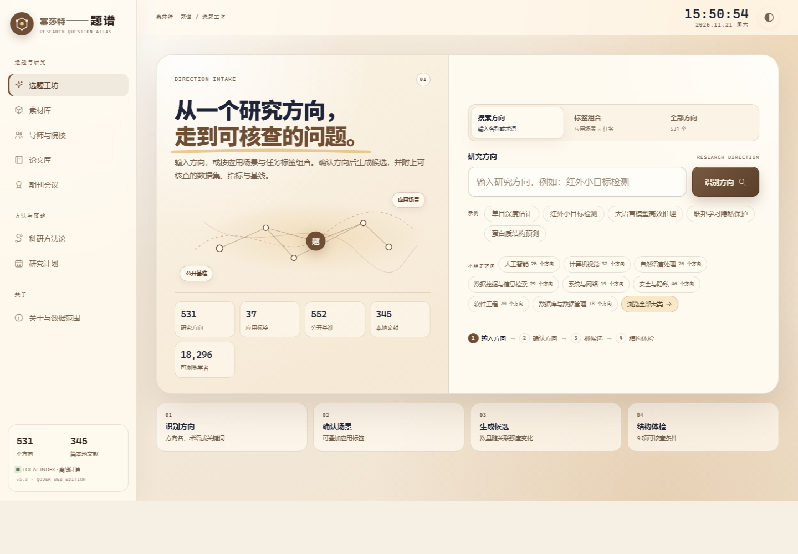
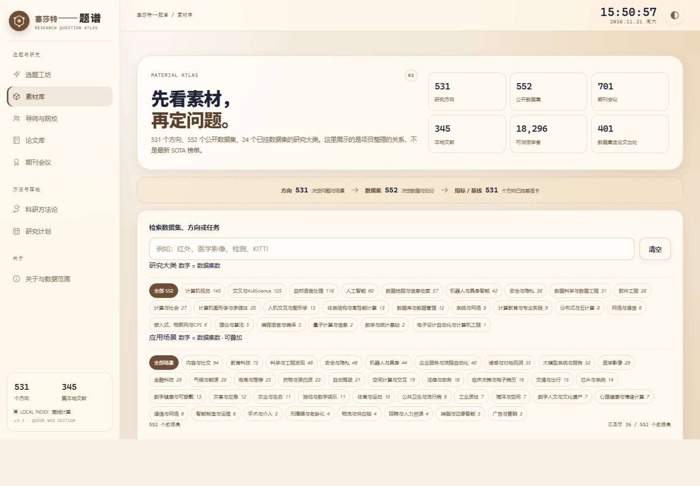
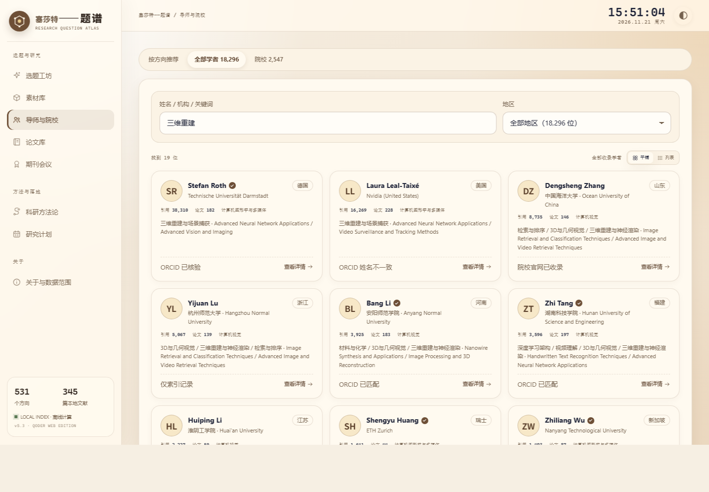
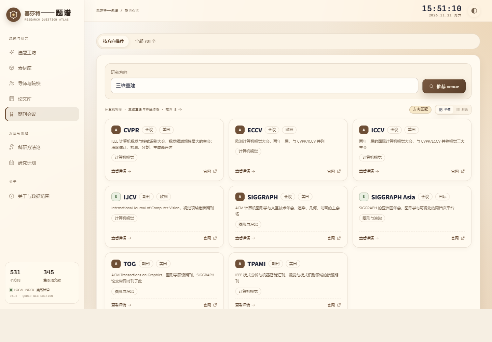
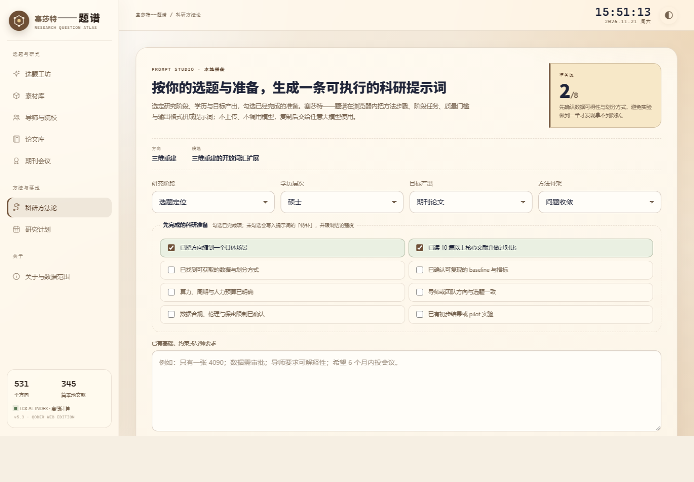
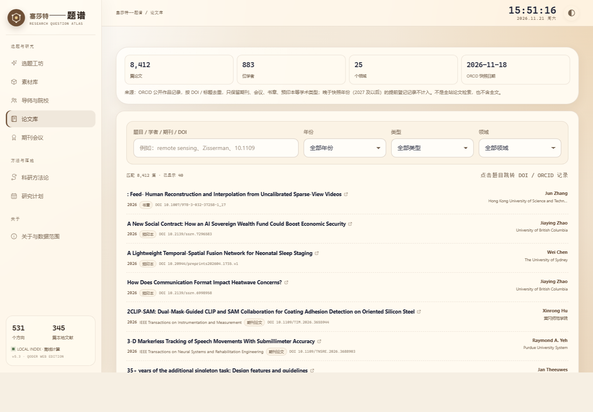

<div align="center">


# 塞莎特——題譜

**Research Question Atlas**

**把一句模糊的研究方向，拆成一串可以逐條核實的選題判斷。**

[简体中文](README.md) · [English](README.en.md) · [繁體中文](README.zh-TW.md)

[](#最新更新)
[](#快速開始)
[](#三個零)
[](https://topic-compass-jzkhsw942zj.qoder.website)
[](#授權)

</div>

---

## 網頁試一下

不想先裝 Python？這裡有一個唯讀演示站，打開就能用：

**<https://topic-compass-jzkhsw942zj.qoder.website>**

九個頁面都能逛：選題工坊（輸入一個方向，看候選選題和它的結構體檢）、導師與院校、文獻庫、期刊會議、科研方法論、研究計畫。資料是打包好的公開快照，不用登入，也不會往你的機器上寫任何東西。

它唯讀。要用自己的 PDF 文獻庫、跑本機語意檢索、看「文獻空白」，還是裝桌面端 —— 見下一節。

---

## 為什麼叫塞莎特

> 「知識是人類締造巴別塔的階梯」

在探索科研的道路上，我做過無數次嘗試與研究，也帶過一批又一批的學弟學妹。在 AI 不那麼發達的時代，很多知識、很多技術、很多次的方法，都是每一個科研人用不同的方式在不同的領域進行不斷的探索。熬過很多個日夜，看見過多少次太陽升起，在科研的道路上，在無數知識所締造的巴別塔的過程中，那些日子是如此印象深刻。

因此，我想，在當下的 AI 時代，有沒有一種設計，能幫助我們這些求道者一個入門的快速方式，一個更好的神兵利器，能夠作為在許多不知道怎麼科研的新手面前，一個整合的工具箱？一個能夠在不斷開發和提升的、適合每個人自己的一個科研助手——也不能說是幫助，只是希望各位能夠獲得更好的一個起點，去做各種各樣的研究與內容。

所以，塞莎特（Seshat）題譜這個項目，我們就在這樣的想法下誕生了。為什麼選擇這個名字呢？因為她是古埃及主管抄寫和記錄的女神，代表著知識的傳承、記錄與創造。

當世間一切都可以被記錄，當所謂的知識庫的設計能夠更好地幫助完成自己的創造，那麼，這個項目無論起到了什麼作用，只希望你在使用時，能夠想起那些個不斷鑽研知識時所熬的夜晚中，在知識的海洋裡尋找著獨屬於自己的那一份科研淨土。

建立起屬於自己的巴別塔吧。

---

## 目錄

- [網頁試一下](#網頁試一下)
- [為什麼叫塞莎特](#為什麼叫塞莎特)
- [它為什麼存在](#它為什麼存在)
- [快速開始](#快速開始)
- [研究者遇到的困境，塞莎特——題譜怎麼回應](#研究者遇到的困境塞莎特題譜怎麼回應)
- [我們珍視什麼](#我們珍視什麼)
- [十四個頁面](#十四個頁面)
- [三個零](#三個零)
- [為什麼沒有分數](#為什麼沒有分數)
- [七套科研方法論](#七套科研方法論)
- [資料規模與口徑](#資料規模與口徑)
- [我們堅持的底線](#我們堅持的底線)
- [已知限制](#已知限制)
- [維護與驗證](#維護與驗證)
- [倉庫結構](#倉庫結構)
- [最新更新](#最新更新)
- [致謝](#致謝)

---

## 它為什麼存在

### 凌晨一點，你打開第三十個分頁

你大概經歷過這樣的時刻：指導教授說「你先找個方向」，你在 arXiv 上翻了兩小時，收藏了四十篇論文，關掉電腦，發現自己比兩小時前更不知道要做什麼。

問題不在你不努力。問題在於——**「這個方向還有什麼可做」這句話，沒有地方可以查**。

論文庫裡躺著幾十萬篇論文，但沒有任何一個介面會告訴你：「方法 A × 任務 B 這個格子，最近三年有 51 篇；而方法 C × 任務 D 這個格子，一篇都沒有。」你得自己讀完所有論文才能知道這件事，而讀完所有論文需要四年，不是一個晚上。

### 選題不是靈感的產物，是一串可以檢查的判斷

跟指導教授聊過幾次以後，你會慢慢發現：**好的選題不是想出來的，是被一條一條篩出來的**。

- 這句話描述的問題，在什麼場景、哪一步失敗？差多少？
- 已經有誰做過相近的事？我和他們的差別，能不能用一句話說清？
- 如果我的機制成立，螢幕上應該出現一個什麼樣的數？
- 如果兩週後它就是不行，我靠什麼承認失敗？

這些問題有標準答案形式，但沒有標準答案。大多數學生卡住的不是「想不出點子」，而是**從來沒有人把這些判斷項列成一張表，讓他挨個打勾**。

### 所以我們做了塞莎特——題譜

塞莎特——題譜把這些判斷做成介面：輸入一個方向，它給你 18 條帶獨立論證的候選、一張指出「全庫沒人做」的組合矩陣、一份 9 項結構體檢、一份真實學者名單、一份期刊會議名單，以及七套逼你把話說清楚的方法。

它不會替你決定做哪條。它只是保證——**在你決定之前，該看的材料你都已經看到了**。

---

## 快速開始

### 你需要什麼

| 項目 | 要求 |
| --- | --- |
| 系統 | Windows 10 / 11（125% 顯示縮放已驗證） |
| Python | 3.10 及以上（開發環境用 3.12） |
| 依賴 | `numpy` 1.26、`scikit-learn` 1.8，外加標準庫自帶的 Tkinter；無其他第三方套件 |
| 網路 | 核心功能完全離線；「最新研究」「抓取新論文」「下載到知識庫」「刷新學者庫」四件事需要連網 |
| 安裝 | **沒有安裝程式**，也不需要安裝程式 |

### 三種啟動方式

```powershell
# ① 最簡單：雙擊 启动.pyw（等同於 python 启动.pyw）

# ② 命令列：用你裝好 numpy / scikit-learn 的那個 python
python app_main.py

# ③ 免 Python 的獨立客戶端（整個目錄拷走即可）
dist\知识库助手\知识库助手.exe
```

> 如果 `python` 指向的是一套沒裝相依套件的直譯器（例如系統內建的 3.9），換成裝了 `numpy` 和 `scikit-learn` 的那一個，例如 `C:\Python312\python.exe app_main.py`，或設個環境變數 `setx KB_PYTHON "…\python.exe"` 給 `start_widget.bat` 用。

### 試一下這五句話

打開「選題工坊」，把下面任何一句貼進去。這些都是真實的中文口語，它會先辨識方向、再讓你確認、最後才產生候選。

```text
我对红外小目标检测感兴趣，但不知道还能做什么
做医学图像分割，想找一个能两周内验证的切入点
单目深度估计这个方向还有没有没被做烂的题目
想做模型压缩，但不想和量化剪枝那批人撞车
帮我看看三维重建里有没有方法和任务还没配上的组合
```

### 想在瀏覽器裡先看一眼

不用安裝，直接打開公開示範站：**https://topic-compass-jzkhsw942zj.qoder.website**

那是塞莎特——題譜的**唯讀示範形態**（9 個頁面：開場、選題工坊、素材庫、導師與院校、文獻庫、期刊會議、科研方法論、研究計畫、關於與資料範圍；靜態站，不接後端、不呼叫模型、不需要帳號）。桌面端獨有的 53.8 萬篇 arXiv 向量查重、PDF 全文檢索、線上大型語言模型、下載與畫像管理，在示範站上不提供——這一點站在頁面上寫明了。

---

## 研究者遇到的困境，塞莎特——題譜怎麼回應

| 你真正遇到的問題 | 塞莎特——題譜的做法 | 在哪一頁 |
| --- | --- | --- |
| 「我這個方向還有什麼可做？」 | 方法 × 任務 × 問題維度的組合矩陣，每個格子標出全庫有幾十篇還是 0 篇 | 文獻空白 |
| 「有想法，但說不清楚」 | 9 項結構清單逐條核查，缺哪項就給哪項的具體動作；不給你一個分數 | 選題工坊 |
| 「這條題是不是已經被人做完了？」 | 候選點開才核查（不假裝核過），給出真實鄰近論文與撞題風險檔位 | 選題工坊 |
| 「最近同儕都在發什麼？」 | arXiv / OpenAlex / Europe PMC 三源合併，按月份排時間軸 | 最新研究 |
| 「找誰？國內誰在做這個？」 | 21,847 位研究者索引，按方向匹配、按省份篩選、按院校中文名查 | 導師與院校 |
| 「投哪？截稿什麼時候？」 | 按方向匹配期刊會議，直達首頁，並明確標註哪些連結只是 DBLP 目錄 | 期刊會議 |
| 「庫裡就 345 篇 PDF，我搜尋找不到想找的」 | 中文輸入做語意檢索，附匹配理由 | 文獻庫 |
| 「下一步到底該幹什麼？」 | 七套方法裡挑一套，它要求你交出一個具體格式的產出 | 科研方法論 |

---

## 我們珍視什麼

**判斷權在使用者手裡。** 塞莎特——題譜給材料、給結構、給反例，不給結論。它從不寫「這條選題值得做」，只寫「這條還缺第 6 項」。

**沒做過的事不裝作做過。** 新穎性核查只涵蓋 arXiv cs 近三年，頁面上就這麼寫；候選沒點開就不顯示核查結論；學者匹配不等於招生名額，介面上標了「請查院校官網」。寧可讓你多走一步，也不讓你在錯誤前提上多花一個月。

**離線優先，資料不出機器。** 除四個連網功能外，全部計算在本機完成。你的選題、畫像、記憶錨點，一個位元組都不上傳。

**不靠縮小字級解決版面問題。** 字級下限 13px，全部對照 WCAG AA 校驗對比度。資訊密度靠結構承擔，不靠把字擠小。

---

## 十四個頁面

> 每個頁面只回答一個問題。

| 頁面 | 它回答的那個問題 | 介面 |
| --- | --- | --- |
| **總覽** | 現在該做什麼？（文獻數、本週新增、我的選題、下次抓取時間、入庫節奏） | [暗色](docs/images/dark/01-home.png) · [淺色](docs/images/dark/20-home-light.png) |
| **選題工坊** | 這個方向能拆出哪些候選？每條候選自己的理由和最小驗證是什麼？ | [截圖](docs/images/02-topic.png) |
| **文獻空白** | 全庫裡哪些「方法 × 任務 × 問題」的格子是空的？ | [截圖](docs/images/03-gap.png) |
| **最新研究** | 這個方向最近三個月同儕發了什麼？ | [截圖](docs/images/dark/08-latest.png) |
| **創新點庫** | 我攢下來的這些選題，各自走到哪一步了？ | [截圖](docs/images/dark/04-ideas.png) |
| **科研方法論** | 我現在缺的那一塊，該用哪套方法補？ | [截圖](docs/images/dark/09-skills.png) |
| **導師與院校** | 這個方向國內有誰在做？在哪個省、哪所學校？ | [截圖](docs/images/06-mentor.png) |
| **期刊會議** | 這個方向該投哪裡？入口是官網還是只是個論文集目錄？ | [截圖](docs/images/07-venue.png) |
| **文獻庫** | 我硬碟上這 345 篇 PDF，哪一篇是我要的？ | [截圖](docs/images/dark/07-library.png) |
| **方向圖譜** | 我感興趣的這幾個詞，在學科體系裡分別落在哪？ | [截圖](docs/images/08-map.png) |
| **個人畫像** | 我這段時間的注意力到底偏到哪裡去了？ | [截圖](docs/images/dark/11-profile.png) |
| **設定與資料** | 路徑、金鑰、抓取詞、產出目錄都放在哪？ | [截圖](docs/images/dark/12-settings.png) |

介面通用操作：`Alt+←` / `Alt+→` 或滑鼠側鍵前進後退，麵包屑可點回，`Ctrl+K` 全文檢索，`Ctrl+Shift+L` 切換明暗主題，`Esc` 關閉二級視窗。

### 幾張真實的介面

下面每一張都是本倉庫跑出來的真實截圖，不是擺設的樣圖。頁面來自 Qoder 版網頁端（左下角標著 `LOCAL INDEX · 离线计算` 與 `v5.3 · QODER WEB EDITION`），入口在「關於與資料範圍」裡的工作臺位址，資料跟著桌面端同一個知識庫走——左側欄那組數字（536 個方向 / 345 篇本地文獻）就是這臺機器上的實際讀數。

| 選題工坊：輸入一個方向，給出帶理由的候選 | 素材庫：本地文獻、筆記與標籤 |
| --- | --- |
|  |  |

| 導師與院校：按方向推薦，標明誰能用 ORCID 核驗 | 期刊會議：標明入口是官網還是 DBLP 目錄 |
| --- | --- |
|  |  |

| 科研方法論：把選題準備拼成一條可執行的提示詞 | 文獻庫：硬碟上這些 PDF，哪一篇是我要的 |
| --- | --- |
|  |  |

---

## 三個零

| 零 | 具體指什麼 | 代價 |
| --- | --- | --- |
| **零雲端** | 選題產生、結構診斷、文獻空白、語意檢索全部在本機算 | 無——反過來還更快 |
| **零額外依賴** | 只用了 `numpy` + `scikit-learn` + 標準庫 Tkinter，沒有 Electron、沒有 WebView、沒有 openai SDK | 打包體積 196 MB，比同等 Electron 方案小一半以上 |
| **零 API 費用** | 不設任何金鑰就能用完所有核心功能 | 少了「AI 挑刺」「AI 總結」這類錦上添花的功能，但它們都是可選的 |

那 53.8 萬篇 arXiv 的向量索引是怎麼做到不花錢的？本機 `TF-IDF → TruncatedSVD(180 維) → L2 正規化`，索引約 1.4 GB 存在磁碟上，載入佔記憶體約 397 MB，查詢是純 numpy 矩陣乘法。

坦白說，**這不如神經嵌入**。README 裡寫得很直白：本機 343 篇實測「拿標題前幾個詞當查詢，Top1 回到原論文」命中 89.7%、Top3 回到 97.1%（310 條可評），夠用，但不夠驚豔。換來的是斷網可用、不燒 GPU、不傳資料。

---

## 為什麼沒有分數

塞莎特——題譜的 v4.0 曾經給選題打 0–100 分。我們把它刪了，因為實測發現它會被騙：

| 輸入 | 舊版得分 | 系統結論 |
| --- | --- | --- |
| 一個真問題，但描述得樸素 | 30 分 | 「請重做問題定義」 |
| **一整段毫無內容的詞堆** | **77 分** | **「可以準備投稿」** |

只要把「消融、baseline、指標、單卡 GPU、停止條件」這些詞堆在一起，評分系統就會給高分——而那個高分會讓使用者誤以為選題已經成熟。

**現在的做法：不評分，只核查結構。**

| 輸出 | 含義 |
| --- | --- |
| 9 項結構清單 | 問題具體 / 機制可檢驗 / baseline 點名 / 資料與劃分 / 指標定義 / 消融設計 / 資源估算 / 停損條件 / 範圍收斂 |
| 階段 0–4 | 用**硬條件**判檔，不用加權平均（加權平均允許用漂亮話補短板） |
| 缺失項 + 修復動作 | 每一項缺失都對應一個可以直接做的動作 |

而且**不允許裸詞糊弄**：「指標」兩個字不算定義了指標，必須出現 AP50 / F1 / p95 延遲；「消融」兩個字不算設計了消融，得說清消融什麼、和什麼同等條件對比。整段是關鍵詞羅列而不是句子時，所有命中一律作廢並給出警告。

判例：

| 輸入 | 結論 |
| --- | --- |
| 真問題 + 量化差距 + baseline + 劃分 + 指標 + 失敗判據 + 消融 + 算力 + 停損 | `4 可寫成文`（8/9 項） |
| 真問題但沒寫機制 | `1 有問題，缺機制`（2/9 項） |
| 詞堆（哪怕包含全部術語） | `0 尚未成型` + 警告 |

---

## 七套科研方法論

光說「缺 baseline」沒有用，得說清楚怎麼補。所以內建七個可執行方法，每個都配有**產出格式**和**最常見的自欺方式**：

| 方法 | English | 什麼時候用 | 你要交出來的東西 | 最容易騙自己的地方 |
| --- | --- | --- | --- | --- |
| 問題收斂 | Problem Converging | 只有一個模糊興趣 | 一句話問題陳述（條件 + 失效點 + 量化差距）+ 3 條排除理由 | 把「提升效能」當問題。效能不是問題，某種條件下的失效才是 |
| 新穎性核查 | Novelty Check | 已經有了一句話問題陳述 | 鄰近工作表（≥5 篇）+ 差異聲明 + 3 條新穎性理由 | 只找支持自己的文獻。必須主動找「可能已經做過」的那篇 |
| 可證偽假設 | Falsifiable Hypothesis | 確定了機制差異 | 主假設 + 零假設 + ≥2 條替代解釋 + 數值閾值 | 假設寫成「會有提升」。沒有方向和幅度的假設無法被證偽 |
| 最小實驗設計 | Minimal Experiment | 有假設，還沒開始寫程式 | 實驗表（基線/改動/指標/結果/是否通過）+ 一行結論 | 一上來就做完整消融和全資料集。最小實驗只回答一個問題 |
| 證據門檻 | Evidence Bar | 最小實驗有效果，想推成完整課題 | 證據清單（必須/加分）+ 失敗切片分析計畫 | 只報平均指標。平均提升掩蓋失敗的切片，正是審稿人最常攻擊的點 |
| 審稿人視角 | Reviewer Simulation | 課題成形，準備投稿或申請 | 3 條拒稿理由 + 3 條補救方案 + 結論邊界聲明 | 只在心裡過一遍。寫下來的才是真檢查 |
| 開題/投稿結構 | Proposal Structure | 實驗有結果，要寫開題報告或論文 | 五段式敘事骨架 + 3 條貢獻陳述 + 局限性段落 | 先寫方法和實驗，最後才想問題。評閱者是從問題開始讀的 |

在選題工坊診斷完之後，可以直接點「用方法論改進這個選題」，它會按你當前缺的那幾項，把方法串成一段「先做哪幾步」的計畫。

---

## 資料規模與口徑

**數字必須帶口徑，否則就是雜訊。** 下面每個數字都能在倉庫裡對應的檔案上複現——[`docs/origin/README.legacy-full.md`](docs/origin/README.legacy-full.md) 裡記了每個數字是怎麼數出來的。

### 桌面端（2026-11-20 與公開站合併後，按檔案現數）

| 項目 | 現數 | 說明 |
| --- | --- | --- |
| 研究方向 | **536** | 531 個真實方向 + 5 個檢索別名 |
| 學科大類 | **25** | ACM/IEEE-CS/AAAI CS2023 + CCF 專委會 + OpenAlex 主題對映 |
| 期刊會議 | **701** | 677 個帶 `ccfEdition`（即 CCF 推薦目錄版本） |
| 期刊會議入口 | **705** | 官網 174 / DBLP 目錄 527 / 檢索備援 4 |
| 學者索引 | **21,847** | 來自 `advisor_directory_full.json`；公開站可見 18,296 |
| 院校 | **3,178** | 院校全表口徑；學者實際出現過的 2,404 所，其中 2,162 所有中文名 |
| 本機 PDF | **345** | 磁碟實有；其中 344 篇解析出標題與摘要（標題 341、摘要 329） |
| 公開基準資料集 | **552** | 25 個指標 / 25 個基線 / 72 個方向 |
| ORCID 論文 | **8,412** | 公開站口徑，帶 DOI |
| arXiv 向量索引 | **538,189** | cs 分類，TF-IDF + SVD 180 維 |

### 三條合併規則（合併時踩過的坑）

1. **期刊不能按名字去重。** 不同目錄裡同名刊可能指向不同 ISSN。
2. **學者只能按 (姓名, 機構) 唯一。** 只按姓名會把「Hui Li」的 391 個人的併成 1 個。
3. **文獻兩邊不對齊。** 桌面端是「讀過的 PDF」，公開站是「存在的發表」，標題零重疊，不強行合併。

### 示範站口徑（與桌面端不同，不要混用）

24 個類目 / 531 個方向（+5 別名）/ 345 篇本機文獻標題統計 / 701 個期刊會議 / 18,296 位學者檢索索引。

---

## 我們堅持的底線

1. **不虛構。** 不編造實驗結果、不編造引用、不編造期刊規則、不編造「這條題沒被做過」。所有數量都標出統計範圍。
2. **只讀必需。** 私有 PDF、金鑰、個人畫像只讀取完成任務所必需的部分；金鑰檔介面預設打碼，一鍵可清除。
3. **連網要你同意。** 外部檢索、下載、模型呼叫都是顯式動作，不會在你不知情時背景抓取。
4. **結論必須可反駁。** 任何判斷都給出依據和範圍；頁面明說「空白不一定是機會，也可能是本來就不該做」。
5. **不承諾做不到的事。** 學者匹配不等於招生名額；新穎性核查「沒查到」只讀作「在我們看得到的範圍內沒查到」。

---

## 已知限制

這一節是複核重點。**每一條都是實測過的，不是猜的。**

| # | 限制 | 嚴重度 | 繞法 |
| --- | --- | --- | --- |
| 1 | 新穎性核查只涵蓋 arXiv cs 近三年，會議正刊/期刊/產業界工作不在裡面 | **高** | 「沒查到」只能讀作「我們看得到的範圍內沒查到」 |
| 2 | 學者匹配 ≠ 招生名額 | **高** | 必須查院校官網 |
| 3 | 語意檢索是 TF-IDF+SVD，不是神經嵌入，Top1 偶有偏差 | 中 | 換關鍵詞；用全域搜尋 |
| 4 | 文獻空白只統計本機 345 篇 | 中（已緩解） | 每條空白已自動拿去 arXiv 53.8 萬篇核實 |
| 5 | 531 個真實方向裡 35 個推薦不出學者（另有 207 個在圖譜頁按關鍵詞精確計數為 0） | 中 | 導師頁會退回相近大類；圖譜頁標「暫無學者 · 索引未覆蓋，不代表無人研究」 |
| 6 | 細方向人數可能極少（深度估計僅 3 位） | 中 | 結果會標註「相鄰方向：立體視覺與 SLAM」 |
| 7 | PDF 作者提取率 53%；約 40 條標題抽取錯誤（雙欄 PDF 上限約 74%） | 中 | 人工看標題與會議 |
| 8 | Europe PMC 偏生物醫學；S2 / DBLP / CORE / Crossref 源目前不可用，實際只剩三源 | 中 | 可單獨取消勾選 Europe PMC |
| 9 | OpenAlex 免費額度 10,000 credits/天，UTC 00:00（北京 08:00）重置 | 中 | 分天跑；429 已做退避重試 |
| 10 | 文獻庫分類是資料夾名，不是學科分類 | 中 | 用語意檢索代替 |
| 11 | 手機端不能離線（區域網路 http 不註冊 Service Worker） | 中 | 用「加入主畫面」 |
| 12 | 網頁體驗端唯讀，5 個檢視；下載/金鑰/畫像/全文檢索/抓取一律 403 | 設計如此 | 回桌面端做 |
| 13 | 候選是組合產生的，不保證創新 | 中（已緩解） | 點開哪條核哪條 |
| 14 | 新穎性核查只核你點開的那些（首次一條約 7 秒，之後約 0.6 秒） | 低 | 沒點過的候選不顯示結論，不會假裝核過 |
| 15 | 預篩池（6 萬篇）做 AND 計數會有小幅漏計（89→69、1279→1208） | 低 | 結論是檔位，不是精確篇數 |
| 16 | 打包版 196 MB（onedir） | 低 | 可自行壓縮 |
| 17 | 抓取全手動，不註冊排程工作；失敗不彈窗 | 低 | 設定頁顯示失敗筆數，可點重試 |
| 18 | 索引格式改動後，舊機器首次重建需約 8 分鐘 / 825 MB 來源資料在磁碟上 | 低 | 不重建也能跑（讀舊格式，只是慢） |

---

## 維護與驗證

```powershell
# 設計權杖與主題一致性（失敗項必須為 0）
python check_tokens.py

# 介面自檢（會真的開視窗）
python tools_smoke_app.py      # 12 項
python tools_e2e_test.py       # 端到端
python tools_test_nav.py       # 前進後退與麵包屑
python tools_test_web.py       # 網頁體驗端（真起 HTTP 服務）
python tools_test_personalize.py
python tools_test_chat.py

# 版面與截圖回歸（1440×900 / 1240×800 / 1080×680 三檔）
python tools_shots_all.py 1440 900
python tools_scan_layout.py 1440 900

# 公開示範站回歸（另開一個視窗跑服務）
cd competition\site\dist; python -m http.server 4173 --bind 127.0.0.1
node competition\scripts\check_site.mjs          # 158 項斷言，含 NO_CONSOLE_ERRORS
```

**測試不會污染你的資料**：`tools_isolate.py` 會把使用者資料重導向到暫存目錄，跑完可以核對 `research_memory.json` 的 mtime 沒變。

> **這些檢查不等同於效果實驗。** 它們證明的是「介面不崩、資料不髒、斷言不破」，不證明「它比別的工具有幫你選對題」。後者需要真實使用者和真實選題做對照，我們沒有做過。

---

## 倉庫結構

```text
knowledge-monitor/
├─ app_main.py              # 主視窗、導覽、十二頁裝配
├─ app_theme.py             # 元件庫（T.Btn / T.Card / T.ScrollArea…）
├─ design_tokens.py         # 唯一設計權杖來源：顏色、字級檔、圓角、間距
├─ page_*.py                # 十四個頁面，一頁一檔案
├─ topic_gen.py             # 候選產生：方向 × 切入角度（22 個角度）
├─ research_diagnose.py     # 9 項結構診斷，硬條件判檔
├─ research_gap.py          # 文獻空白矩陣
├─ novelty_check.py         # arXiv 全庫查重
├─ research_skills.py       # 七套方法論（id/name/en/when/goal/steps/output/pitfall）
├─ advisor_index.py         # 學者索引：四源合併、ORCID 優先去重
├─ kb_vector.py             # 53.8 萬篇 arXiv 向量索引
├─ semantic_search.py       # 本機 345 篇的 TF-IDF+SVD 檢索
├─ paper_sources.py         # OpenAlex / Europe PMC / arXiv 三源適配
├─ web_server.py            # 網頁體驗端（唯讀 5 檢視，7 開放 5 拒絕）
├─ web_static/              # 網頁體驗端前端
├─ competition/
│  ├─ site/                 # 公開示範站原始碼
│  └─ scripts/              # 資料匯出、驗收、截圖
├─ docs/
│  ├─ origin/               # 歷史文件存檔（舊 README 全文、功能說明手冊等）
│  ├─ images/               # 本 README 的配圖（light 場景 / dark 整窗 / web 網頁端）
│  └─ screenshots/          # 站內文件用截圖
├─ tools_*.py               # 測試與工具腳本
└─ AGENTS.md / PRODUCT.md / DESIGN.md
```

改 README 配圖的完整流程（別跳過第一步，否則數字對不上）：

```bash
# 1. 先跑隔離環境下的互動檢查，順帶產出 1440×900 的全頁截圖到 screenshots/new/
python tools_shots_all.py 1440 900
# 2. 需要整窗（含邊框、含淺色主題）的圖，用這個；尺寸靠位置參數給
python -X utf8 tools_shot_pages_all.py 1440x900
# 3. 挑圖拷進 docs/images/，再用 ⬇ 校驗所有圖片與錨點
python check_tokens.py
```

---

## 最新更新

> 節選最近幾條。完整體檢記錄見 [`docs/origin/README.legacy-full.md`](docs/origin/README.legacy-full.md)。

### 「文獻空白」右欄一直是空的 · 2026-11-20

`page_gap.py` 裡 `_render_issue_gaps(self, issue_gaps, holder)` 的形參叫 `holder`，函式體卻一路用 `box`——而 `box` 在這個作用域裡從來沒定義過。結果每張「問題維度」卡片都拋 `NameError: name 'box' is not defined`，右欄直到「全庫核實」回呼才有內容。

這個 bug 藏了很久，不是因為它難，而是**因為測試根本不看**：截圖腳本只等「有列」就拍，拍到的是載入中的空態；狀態列的紅字又被 6 秒後的「就緒」洗掉。這次順手補了兩道閘門——狀態列出「執行錯誤」直接失敗，導師頁要等按鈕不再是「匹配中…」才算跑完。

### 開場頁在窄高視窗下不再空白 · 2026-11-20

公開示範站在 1189×1475 這類「窄而高」的視窗下，插圖曾被推出首屏，右半邊只剩一個軌道環。根因是 `intro.css` 裡的一條 `max-width: 960px` 斷點把所有寬度都變成了單欄堆疊。

現在新增 `min-width: 1121px` 且 `min-height: 1242px` 的斷點恢復雙欄，插圖尺寸改由 JS 按容器實際寬高計算，並在圖片解碼失敗時乾淨收合而不是留一個空洞。九個尺寸（700×900 到 1920×1080）逐一截圖核對。

### 期刊會議入口不再假裝是官網 · 2026-11-20

701 條入口裡有 527 條其實是 DBLP 論文集目錄頁，點進去只能看到歷年論文列表，沒有截稿日期和範本。現在頁面上明確區分：真官網寫「官網 ↗」，DBLP 寫「DBLP ↗」，並在詳情區給出「這裡只是 DBLP 記錄的歷年目錄，不含截稿日期、範本與版面費」的說明。

同一輪裡，網頁體驗端的方向口徑從 12 類 / 64 小類修正為 25 類 / 536 個方向（原先直接把 PDF 轉出的 16 個文字檔數量當成了大類數），學者索引的合併規則也修正了 Unicode 連字號變體導致同一個人被拆成兩筆的問題。

### 換台電腦也能直接跑 · 2026-11-20

原本有三處路徑寫死在這一台機器上，搬到別的電腦不會報錯，只會**悄悄少掉功能**：文獻索引拿絕對路徑當鍵，換了磁碟機代號，標題、摘要、作者和全文檢索全部對不上；arXiv 向量索引固定在 `G:\kb-vector`；預設知識庫路徑也是絕對路徑。

現在索引鍵改成了 `<知識庫>/新論文/xxx.pdf` 這種與磁碟機無關的寫法（兩種寫法都認，不需要重建索引），向量索引目錄依序讀環境變數 `KB_VECTOR_DIR`、`config.json` 的 `kb_vector_path`、最後才退回原路徑，知識庫預設取程式目錄下的 `知識庫/`。索引確實不在本機時，「文獻空白」會明說找不到的是哪個目錄、該怎麼指過去，而不是默默回傳空。

### 文件口徑對齊 · 2026-11-21

三份 README 裡寫死的數字過了一輪總帳：桌面端是 14 個頁面（原本標題寫「十二個頁面」）、公開示範站是 9 個頁面（原本寫 7 個）、學者索引 21,847 位、本機 PDF 345 篇（其中 344 篇解析出標題和摘要）。同一輪也清掉了 ORCID 發表記錄裡原樣帶過來的富文字標題——8,412 筆裡有 46 筆的題目帶著 `<p style=...>`、`<div><span>` 這類標籤，網頁端直接把它們當文字顯示了出來。現在這些標籤會被就地刪掉，`R<sub>y</sub>` 這類下標也不會被拆成 `R y`。

## 致謝

- 學科口徑參照 **ACM / IEEE-CS / AAAI CS2023** 課程體系與 **CCF** 專委會分類。
- 學者與主題資料來自 **OpenAlex**（CC0），身分核驗來自 **ORCID**。
- 論文中介資料來自 **arXiv**、**OpenAlex**、**Europe PMC**；期刊會議目錄參照 **CCF 推薦國際會議與期刊目錄**。
- 名字「塞莎特——題譜（Research Question Atlas）」取自埃及書寫與測度之神 Seshat —— 她管抄寫與記錄，也管測度與建屋；把方向整理成譜系，正是這件事的形狀。

---

## 授權

本倉庫程式碼的授權，請見倉庫根目錄的 LICENSE 檔案。第三方資料（OpenAlex / ORCID / arXiv / Europe PMC）遵循各自授權，本專案僅作引用與統計，不再分發原始資料集。

---

<div align="center">

**塞莎特——題譜不會告訴你該做什麼題。**
**它只確保，在你決定之前，該看的材料你都已經看到了。**

</div>
